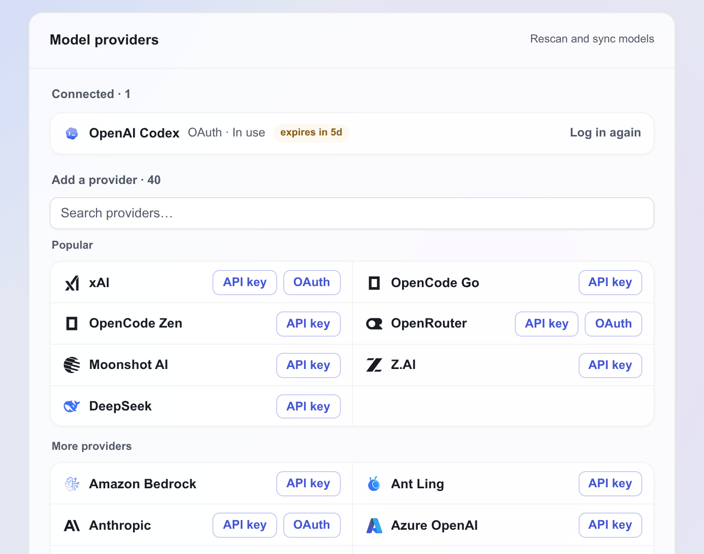
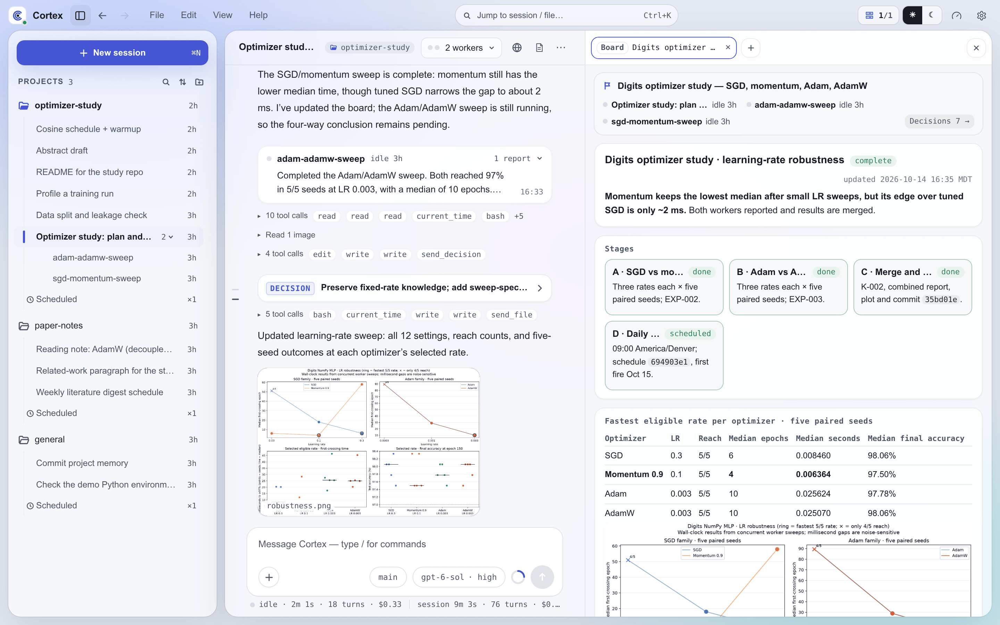
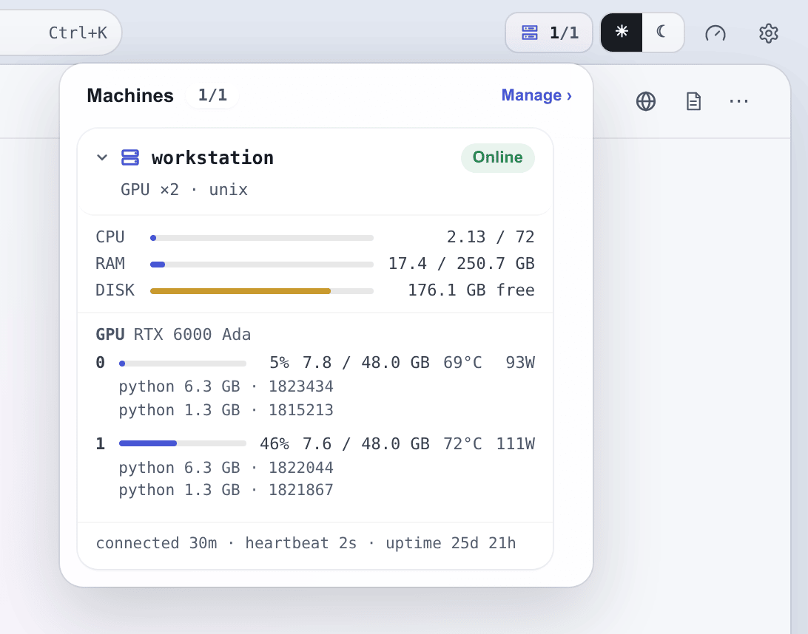
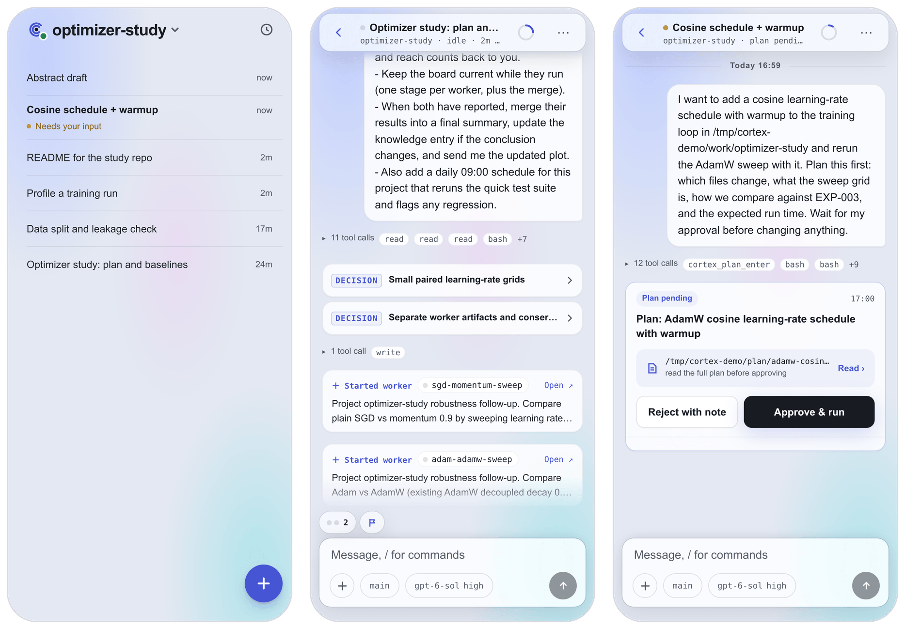

# Desktop and Android Apps

Cortex provides a Tauri v2 native shell for Linux, macOS, Windows, and Android. The desktop shell presents the three-pane workbench; Android presents a phone-specific interface built around the session list and a swipe-in Projects panel. Both connect directly to a Cortex server over the Web UI HTTP transport and use the same projects, sessions, approvals, files, and memory as the browser workbench.

The native apps require a reachable Web UI endpoint and a one-time pairing code (or the server's `CORTEX_CLIENT_TOKEN`). Browser access uses a separate Cloudflare Access path described in [Browser Access](browser-access.md).

The desktop app can either install a Cortex server on the computer it runs on or connect to one that already exists. The first screen asks which, and the local path needs no terminal: it installs the package, writes the configuration, starts the daemon, and connects. Android is remote-only, since it has no place to run a Node process.

## Installation

For server releases that include native packages, download the platform asset from the [GitHub Releases page](https://github.com/fangxm233/cortex-agent/releases). The release policy assigns the native UI exactly the same CalVer as the corresponding server release: `YYYY.M.D[-N]`. The version embedded in the app and shown in the asset name must match the `server-v<version>` tag.

| Platform | Native release package | Installation |
|---|---|---|
| Linux x86_64 | AppImage, DEB, or RPM | Run the AppImage directly after `chmod +x`, or install the distribution package. |
| Windows x86_64 | NSIS `setup.exe` | Run the installer and launch Cortex from the Start menu. |
| macOS Apple Silicon | `macOS-aarch64` DMG | Open the DMG, then drag Cortex into Applications. |
| macOS Intel | `macOS-x86_64` DMG | Open the DMG, then drag Cortex into Applications. |
| Android arm64 | Signed APK | Open the APK and allow installation from the selected file source when Android asks. |

Linux AppImage builds require WebKitGTK and GTK at runtime. Ubuntu and Debian users can install the common runtime libraries with:

```bash
sudo apt-get install libwebkit2gtk-4.1-0 libgtk-3-0
```

Windows 10 and 11 normally include WebView2. If Cortex reports that WebView2 is missing, install the Microsoft Evergreen WebView2 runtime before launching the app. Release installers without an Authenticode certificate may also trigger a Microsoft Defender SmartScreen warning; review the publisher and release checksum before choosing to run one.

A macOS package without a Developer ID certificate is ad-hoc signed but not notarized. Gatekeeper may prevent the first normal double-click launch. Open Cortex once with Finder's **Open** action or approve it under **System Settings → Privacy & Security**. Ad-hoc signing verifies the bundle structure but does not establish a trusted publisher identity.

The Android APK is intended for arm64 devices and is distributed outside the Play Store. Android therefore asks for permission to install from the browser or file manager used to open it.

## Installing a server from the app

Choose **Install Cortex** on the first screen and wait for installation to finish. Setup needs no terminal, Homebrew, Command Line Tools, or administrator access. Progress stays brief; **Activity log** is a folded troubleshooting entry. If installation fails, follow the message and choose **Try again**. **Cancel** during installation stops the active installation step, not an existing server; it does not undo files already installed.

Each desktop installer carries the runtime the local server needs: the official Node.js 24 build for its platform and, on Windows, Git for Windows (PortableGit) with Git Bash. Setup unpacks them into versioned directories under `~/.cortex/runtime`, then uses that npm to install the Cortex server package into the private prefix `~/.cortex/runtime/prefix`. Only the server package, and Claude Code when you choose to install it, come from the npm registry; npm follows your `.npmrc` registry, proxy, and credential settings. Setup does not change global npm settings, and it neither uses nor modifies a Node.js, npm, Git, or `cortex` already installed on the computer. The server adds the `cortex` command to new terminal windows itself, described in [Using cortex in a terminal](#using-cortex-in-a-terminal).

The local server always runs on the bundled runtime. When a runtime directory is missing or damaged, the app unpacks it again during setup, or at launch before it starts the daemon. A saved server installation that no longer runs, or is older than the app requires, is reinstalled into the private prefix. On Windows, Cortex runs shell commands with the bundled Git Bash. On macOS and Linux, Git is optional and setup does not install it; Git-based history and Git-sourced extensions require it.

The bundled Node.js determines where local installation works: macOS 13.5 or later, Linux x86_64 with glibc 2.28 or later, and Windows 10 or 11 on x86_64. On other systems the app can still connect to an existing server.

Installation continues automatically through initialization, server startup, and connection. A new installation uses this computer's hostname, port 3004, no login service, and the `cortex` terminal command. There is no machine-settings page or **Start Cortex** confirmation on this path. Progress remains one installation row, with technical details in **Activity log**. A new installation opens provider setup at `/setup/providers` for login and a default model before entering the workbench. PI is bundled with Cortex; setup does not ask you to choose backends.

If initialization, startup, or connection fails, **Try again** reuses the original setup choices. **Edit settings** opens the repair form; starting from this form can restart the local server to apply an explicitly selected port. Automatic setup preserves a responding server. Installation failures offer retry, not machine settings.

Local setup belongs to the native app and the setup page bundled with it; updating the Web frontend or replacing `web/dist` does not change it.

For local development, launch the native app with `CORTEX_SETUP_SERVER_PACKAGE` set to an absolute path to a locally packed `.tgz`. The installer uses that package through npm and checks its reported version against the app's minimum. This does not publish the package; use an isolated home, npm prefix, credential store, and network for fresh-install testing.

The installation step asks nothing about Slack or Feishu: the app is the interface, and a server with no messaging platform runs on its built-in gateway. Provider login and the default model are configured after the server connects.

A machine that already has a Cortex configuration keeps its machine identity and service settings. Automatic setup enables the local connection endpoint without overriding its configured port or running initialization again. It checks the saved installation even when it is already usable, so later launches use the same runtime. Existing installations and connections open the workbench unless a new local installation still has unfinished provider setup.

The app starts the local daemon at launch whenever it is not already answering. **Start at login** also starts it when you log in, so scheduled tasks fire while the app is closed. It is off for a new installation; turn it on from the provider setup page after installation, from **Settings → Advanced**, or from the repair form. On Linux the app registers a systemd user unit and on macOS a launchd agent; both take effect at the next login and do not replace the daemon already running. On Windows it adds a **Cortex** entry to your startup apps that opens the app without a window at login, starts the server, and exits; Task Manager lists it under **Startup apps**, where it can also be switched off. No administrator rights are needed on any platform. At each launch the app points its registration at the runtime and executable it uses, so an update that moves the bundled Node.js or the app takes effect from the next login. Turning the switch off withdraws the registration and leaves the running server alone. A login service set up from the terminal with `cortex init` shows as read-only and stays the terminal's to change. Automatic setup does not create or change a login service, and existing service settings are preserved.

To enable the endpoint on an existing install without the wizard, run one command on the server:

```bash
cortex ui enable
```

This generates the client token if needed, sets `CORTEX_UI_HTTP` and `CORTEX_UI_PORT`, and adds the app's origins to `uiCorsOrigins`. Restart the daemon afterwards when it reports that the configuration changed. `cortex ui pair` then prints a one-time pairing code for the first app (see [First connection](#first-connection)). [Server configuration](#server-configuration) describes the same settings by hand.

### Using cortex in a terminal

A server running from the app's runtime checks for its terminal launchers each time it starts. If they are missing, it runs `cortex path install` itself. New installations get the command this way, and so do existing ones after a server update. The command writes launchers for `cortex`, `cortex-signal`, `cortex-hook` and `cortex-evidence-export` into `~/.cortex/runtime/bin`. Each launcher starts the bundled Node.js with the installed server, so a terminal needs no Node.js of its own. That directory is on `PATH` in every terminal opened afterwards:

- **Linux and macOS:** a block marked `# >>> cortex >>>` sits at the end of `~/.profile`, and of `~/.bash_profile` and `~/.zshenv` where those shells are in use. The same block sits at the top of `~/.bashrc`, so `ssh host cortex …` works as well. fish is not configured; add the directory with `fish_add_path ~/.cortex/runtime/bin`.
- **Windows:** the directory is part of the user `Path`, which Command Prompt, PowerShell and Git Bash all read.

When the server starts on a different bundled Node.js, for example after an app update, it rewrites the launchers to match. `cortex path status` shows the launchers and where they are registered. `cortex path remove` deletes them and takes the directory back off `PATH`. The removal is recorded in `~/.cortex/runtime/terminal-cli.json`, and the server does not add the command again until `cortex path install` runs. The **Use cortex in the terminal** switch on the repair form runs one command or the other.

Agent sessions do not depend on any of this. The server puts its own `node`, `cortex` and `cortex-signal` on the `PATH` of every session it starts, so skills and waitpoint commands work even with the terminal command turned off. If adding the command fails, the server logs the error and tries again at its next start. When the repair form's switch is on, setup also shows a warning.

## Provider setup

{ width="640" }

The provider setup page, **Connect a provider**, runs top to bottom: a **Claude Code** card, the **Model providers** card, a default-model choice, and the optional leaderboard card. **Model providers** lists the providers whose credentials are already detected under **Connected**, and the rest under **Add a provider**: a search box above a two-column grid, with a **Popular** group first and **More providers** below it. Choose a provider and a supported OAuth or API-key method to open the same login modal used by **Settings → Accounts**. PI needs no separate installation. OAuth may open your browser and require authorization or MFA; login is not guaranteed to stay inside the app.

**Claude Code** is optional and separate from the Anthropic provider in PI. In local desktop setup, **Install and sign in** authorizes installing Claude Code on this computer, then opens its login flow. This is the only onboarding step that offers its installation. An existing Claude Code installation is reused.

Credential detection is not a live inference test: setup sends no paid inference request and does not prove that a model call will succeed. Missing, expired, or unknown credentials need attention even when the runtime is installed.

After login, the page refreshes credentials and synchronizes gateway and model configuration. Rescanning also picks up credentials configured elsewhere. Sync supplies a recommended default when none is configured and adds a recommended favorite for each connected backend/provider group that has none. Existing defaults and favorites are preserved. First-run setup asks you to choose a default model from favorites with a matching configured account before entering the workbench; login alone is not enough.

The optional **Public usage leaderboard** card puts your token usage on the public [aistatus.cc leaderboard](https://aistatus.cc/leaderboard), which shows your name, organization, and token counts. It is off unless you have already joined. Switch it on, enter a name and an email (the organization is optional), and choose **Save**; the email only identifies you and is never displayed. The card does not affect **Enter workbench** or **Set up later**, and the same card stays available under **Settings → Usage**.

Below it, **Start at login** is the same switch as in **Settings → Advanced** and appears only for a server this app installed. **Help improve Cortex** is the server's anonymous telemetry setting, the same one as in **Settings → Privacy**. [Telemetry](telemetry.md) describes what is sent.

Choose **Enter workbench** when the configuration is ready, or **Set up later** to skip. The skip warning explains that the Agent may be unavailable until you finish **Settings → Accounts** and **Settings → Models**.

After a new local installation connects, quitting on this page and reopening the app resumes provider setup—even if you have not signed in. Login alone does not finish setup. **Enter workbench** and deliberate **Set up later** save your choice before leaving, so later launches open the workbench. If saving fails, stay on this page and try again. Older unmarked installations and remote connections keep their usual startup behavior.

## Server configuration

The native shell talks to the server's opt-in Web UI endpoint. The endpoint itself is startup topology, so it stays in `$CORTEX_HOME/config/.env` on the server:

```bash
CORTEX_UI_HTTP=1
CORTEX_UI_PORT=3004
```

The allowed CORS origins are a runtime setting. Add or confirm the `uiCorsOrigins` key in `$CORTEX_HOME/config/settings.json` (see [configuration.md](./configuration.md#configsettingsjson)):

```json
{
  "uiCorsOrigins": [
    "cortexui://localhost",
    "http://cortexui.localhost",
    "tauri://localhost",
    "http://tauri.localhost"
  ]
}
```

The legacy comma-separated `CORTEX_UI_CORS_ORIGINS` variable in `.env` is still read as a deprecated fallback.

`cortex init` generates `CORTEX_CLIENT_TOKEN` in `.env`. An app that connects with the client token, not a pairing code, uses that exact value; `CORTEX_TOKEN` is not the server-side client-token setting. Retrieve the configured token with:

```bash
grep CORTEX_CLIENT_TOKEN "${CORTEX_HOME:-$HOME/.cortex}/config/.env"
```

Restart the daemon after changing the endpoint in `.env`. A change to `uiCorsOrigins` needs no restart — it is resolved per request. A native app connects to an HTTP or HTTPS URL that reaches this endpoint. When the endpoint is exposed through a tunnel, use a hostname that accepts the Cortex token directly rather than one that requires an interactive browser SSO page.

Current builds serve the shell through the `cortexui` custom protocol, which appears as `cortexui://localhost` or `http://cortexui.localhost` depending on the WebView platform. The two `tauri` origins keep older native builds connectable. The server returns CORS headers only for origins explicitly listed in `uiCorsOrigins`.

## First connection

Choose **Connect an existing server** on the first screen, then enter the server URL, including `https://` or `http://`, and a pairing code in **Pairing code or client token**. Get the code on any signed-in device under **Settings → Machines → Connected apps → Connect a device**, or run `cortex ui pair` on the server (or ask Cortex in chat to run it) — the usual way for the first device. A code is valid for 10 minutes and works once; pasting a pairing link (`https://<server>/#pair=<CODE>`) into the address field fills both fields. On connect the app trades the code for its own device token and stores that. The full `CORTEX_CLIENT_TOKEN` is accepted in the same field as an alternative. **Test connection** with a code only checks that the server is reachable and does not spend the code; with the client token it distinguishes an unreachable endpoint from an unauthorized token. A successful connection opens the workbench and stores the credentials for later launches.

Apps paired with a code appear under **Settings → Machines → Connected apps** on every signed-in device, with when each was paired and last used. **Revoke** signs an app out at once; it needs a new code to connect again. [Pairing codes and connected apps](browser-access.md#pairing-codes-and-connected-apps) covers the details. A server installed by the wizard skips this screen — it connects with credentials it generated itself.

The app stores the connection as `connection.json` in its own data directory: `~/Library/Application Support/dev.cortex.desktop` on macOS, `~/.local/share/dev.cortex.desktop` on Linux, `%APPDATA%\dev.cortex.desktop` on Windows, and the app's private storage on Android. On macOS and Linux the file is readable by your user only. Disconnecting deletes it and returns to the connection screen.

## Desktop workbench



The desktop app uses the same workbench as the browser. The left rail lists projects and project-scoped sessions and links to the selected project's Overview. The center pane contains chat, streamed agent output, tool activity, attachments, question cards, and plan approvals. A slim rail along the chat's left edge marks every prompt in the session. The marks nearest the pointer stretch as it travels down the rail, the one under it previews what was asked, and clicking it scrolls the transcript back to that point. Marks stay lit for every turn the view currently shows, whether it holds the whole turn or only its head or tail.

Each turn of the agent reads as its work, its answer and what it produced. The work — tool calls, thinking, short working notes, subagents — folds into one line above the answer, such as *Worked for 3m 20s · 49 tool calls · 1 subagent*; click it to open the work in order. While the turn runs, that line reads **Working** and stays open, and the text being written already sits where the answer will stay; once a tool call follows it, it was a working note and joins the work. Everything that needs the reader stays in view: plan and question cards (folded to one line once settled), notices, files and decisions the agent sent, boards it opened, workers it started, waitpoints it armed, and long notes the agent clearly wrote for the reader (a heading, a table, or a few paragraphs). While the turn runs, those that arrive once the work has begun sit in the open work where they happened, so the work reads in order and only the text being written sits below it; when the turn ends and its work folds, they stand below the folded line. A turn starts at your message, at a lead's message to its worker, and at a system turn that woke the agent — a waitpoint's signal, a worker's report or question, or a background agent's result that arrived after the turn ended; a resume after a rate limit, or a background result folded into a turn still running, continues the same work. **Settings → Appearance → Work in chat** can keep every turn's work open. When the turn has ended but the session is not done, the end of the chat says so: background work still running (the agent continues when it finishes), or the waitpoint it is waiting on; the waitpoint's own line in the turn reads *waiting* until its signal arrives as a turn of its own.

Model-provided thinking appears separately from the answer, collapsed by default. A standalone **Thinking** row previews its first line; click it to read the full text. Thinking beside tool calls stays inside their collapsed group, which counts it as **Thinking**, and expands in its original position. While it streams, **Thinking…** shows the latest line until the saved row replaces it. Desktop, browser, and mobile chat share this display. Claude supplies a thinking summary; PI supplies the text its provider exposes. Empty, redacted, and subagent thinking is omitted. Slack, Feishu, and the terminal do not display thinking. The server setting [`showThinking`](configuration.md#keys) controls capture; saved thinking survives a refresh, and unavailable past thinking is not reconstructed.

The chat header carries the session's title and, for a lead, its team capsule, and for a session bound to a board, the board capsule ([Team Mode](team.md#in-the-workbench), [Boards](team.md#boards)). The Notes button (⌘⇧N) opens the private notes as a card beneath the header, leaving the composer in view. Directly above the composer, one row of capsules shows what the session is doing: the agent's task list, as a progress ring with the current item, and anything it waits on outside Cortex. The task capsule stays while the list has open items and leaves once a finished list's turn ends. Each capsule opens its detail as a popover, so the composer never moves. On a phone the same row also carries the lead's team and the bound board; each capsule names itself in words (*Tasks 3/7*, *2 workers*, *Board*) and opens a sheet. The phone's chat header says what the session is doing in plain words, such as *Running · 1m 12s · 2 workers* or *Plan waiting for your approval*, and carries context usage beside the ⋯ menu as a small gauge that fills like a pie. Clicking the status line under the composer opens **Session stats**: runs, agent turns, active time, total cost, and the part of the cost spent by subagents.

The composer's engine picker lists favorite models with their remembered thinking levels, grouped by backend/provider. Each row in the full model list has a star to add or remove a favorite, and thinking includes an option to use the backend default. **Settings → Models** manages the default model and favorites; the schedule editor selects a model and thinking level. See [Backends](./backends.md#per-session-model-thinking-level-and-route) for the selection rules.

Typing `/` in the composer opens the slash palette: `/new`, `/cancel`, `/compact`, `/model`, `/settings`, and `/usage`, followed by the skills the session can load. The arrow keys move through it, and Enter or Tab picks an entry. The composer's **+** menu attaches files, lists the same commands, and sets **browser** control for a new session: the agent gets tools to drive Chrome on the server (**this host**) or on a connected device, where the window opens on that machine's screen with the logins already in its profile. Browser control is chosen before the session's first message, because the agent's tools are fixed when it starts; the chosen device then shows as a chip in the composer.

The machines button in the top bar shows how many registered machines are online, such as `2/3`, beside a server icon whose dot is green when every machine is online, amber when some are offline, and red when none are. Clicking it, or choosing **View → Machines**, opens the **Machines** menu, headed by how many are online, with one row per machine: a status dot (green when online, a hollow ring when offline), its name and last heartbeat, and a line with its GPUs, operating system, and how long it has been connected. Expanding a row probes the machine live while the menu stays open. It shows CPU load, RAM, and free disk as thin aligned bars, then one row per GPU with utilization and temperature, with its memory, power draw, and process count beneath; click that line to list the heaviest processes. The machine's uptime closes the row. An offline machine shows *Offline — no live telemetry*. **Manage ›** opens **Settings → Machines**. On Android, **Machines** is a drill-in screen with one card per machine, the same vitals, and a GPU grid.

{ width="480" }

The right-hand dock (**View → Dock pane**, `⌘J` or `Ctrl+J`) holds tabs beside the chat: docked file previews, boards, web pages, and agent browsers. Each session keeps its own tabs and its own open or closed dock, so selecting another session swaps the dock to that session's tabs, and switching back finds them as they were. Right-click a tab and choose **Pin tab** to keep it in every session: pinned tabs lead the tab strip, a pin replaces their close button and unpins them when clicked, and the same menu closes them. Opening a session from a board opens the board in that session's dock too. An **Agent browser** tab shows the page a session's agent is driving, live, and lets you take it over; [Agent Browser](agent-browser.md) covers it. A web tab takes a port or a URL. Its **Ports** list shows the ports listening on the server or on a connected device, and the desktop app forwards a chosen port through its token-authenticated `/forward` tunnel, so a development server on a remote machine opens as if it ran locally. A browser cannot forward, and opens those ports as plain `localhost` addresses.

Consecutive tool calls collapse into one row that says what they did — *Ran 6 commands · Edited parser.ts · Called send_decision* — and opens to one line per call with its command or path. Thinking between the calls belongs to the same row, including a thought still being written right after one. While the row is what the agent is doing right now, it ends with the step under way — *Running pnpm test*, *Reading parser.ts*, *Thinking* — and the line rolls to each new step. Calls whose result returned images — `Read` on an image file, PI's `read`, `remote_read`, or any MCP tool that answers with an image — form rows of their own, labelled *Read N images*: consecutive image reads share one row, and rows keep the order the calls ran in, so reads interleaved with other tools alternate with them. Expanding it lists each of those calls with its images beneath it, at most 120 px high; clicking an image opens it in the media viewer. A read call's image carries the name of the file it read. The row shows only what the model received: a PI model that takes no image input is never sent a tool's images, so its calls stay in the ordinary row. Mobile chat and subagent blocks show the same rows. The images are kept under `$CORTEX_HOME/tmp/tool-images/<session id>/`.

The chat header's **⋯** menu offers **Star / Unstar**, **Rename**, and **Session ID** on desktop and mobile. **Session ID** shows the session's stable ID and the backend's own UUID, each with a copy button; **Edit → Copy session ID** copies the first directly. In the desktop session list, hovering a row replaces its time with the same actions under **⋯**, without opening that conversation; the control is also available by keyboard focus. Each project's session list has a collapsible **Stars** section; starring moves a session there, and unstarring returns it to its ordinary group. Empty Stars sections are hidden. Names and stars are saved on the server. Rename changes only the display title, not either session ID, and accepts a nonblank title of up to 60 characters.

Execution rows on a project's Overview open a drawer with live logs and cancellation controls. `⌘K` on macOS or `Ctrl+K` on Linux and Windows opens the command palette, which searches commands, pages, sessions, boards, and live agent browsers. The **Help** menu holds **Documentation**, **Send feedback** (which opens the GitHub issue tracker), **Daemon status**, **Check for updates**, **Developer tools**, and **About Cortex**.

Code blocks in chat show a copy button while the pointer is over them; on touch screens the button stays visible. On Windows, text copied in the app with `Ctrl+C`, the context menu, or a copy button appears in Clipboard History (`Win+V`) like a copy from any other application. WebView2 writes these copies from its own browser process, which Windows leaves out of the history, so the app shell writes the same data back under its own window. Content its writer marks as excluded from history stays excluded (`desktop/src-tauri/src/clipboard_history.rs`).

### Plugin settings

**Settings → Plugins** shows every plugin on the connected Cortex server, the built-in ones and your own, and edits them in place. Plugins and skills carry a **built-in**, **local**, or **modified** tag. A plugin's **Overview** tab shows its portable or legacy format, manifest metadata, location, validation issues, and the environments that use it. The **Skills** tab opens each skill's `SKILL.md` for editing and offers **New skill**, **Move or rename**, and **Delete**. Saving a built-in skill keeps your version in its place, and **Revert to built-in** restores the shipped one; built-in skills cannot be moved or deleted, and a built-in plugin cannot be deleted but can be switched off per environment. The **MCP** tab edits a portable plugin's root `mcp.json` servers (**Add server**, transport, command or URL, environment, and headers); saved secrets stay hidden and are kept unless you **Replace** them. **New plugin**, **Delete plugin**, and **Convert to portable** manage whole plugins. The desktop shell keeps no separate local catalog because it renders the same server-backed SPA as the browser (`web/src/features/settings/panels/PluginsPanel.tsx`).

**Settings → Environments** edits the [execution environments](./configuration.md#execution-environments) in four tabs: **Body**, **Validation**, **Plugins**, and **System prompt**. The Plugins tab assigns plugins to the environment. Adding a portable plugin with at least one valid inventoried `mcp.json` server requires confirmation before save, and unsaved assignment edits block navigation and closing the Settings modal. If server data changes during editing, the draft stays visible as stale and must be reset before saving. The System prompt tab replaces the environment's entire system prompt for new sessions; it names the file that holds the prompt, warns when other environments share that file, and offers **Restore default**. [Skills and Plugins](./skills-and-plugins.md) describes package formats, runtime behavior, and the trusted-code boundary.

To change servers, open the daemon or connectivity status, choose **Disconnect**, and enter the new endpoint and token on the connection screen.

## Desktop and browser notifications

**Settings → Notifications → System notifications · this device** controls notifications on this device and defaults to on. Browser permission is separate: click **Allow notifications** to grant it. Browsers require HTTPS or localhost and a supported Notifications API; a denied permission must be changed in the browser's site settings.

While the desktop app or browser page is running and connected, completed replies, sessions that start waiting for your answer or approval, and system notices use operating-system notifications when the window is hidden or unfocused. In the foreground, Cortex keeps its in-app notifications and suppresses those for the conversation being viewed. Team workers raise neither; their lead's reply does ([Team Mode](team.md)). Disabling system notifications, missing permission, or a delivery error leaves the in-app notifications available.

Clicking a session notification restores/focuses the app or browser page and opens that conversation. A system notice without a conversation only focuses the window. Desktop click routing requires the native notification bridge in the installed app; a frontend update alone cannot add it to an older shell. Switching servers invalidates pending desktop notification targets.

Desktop and browser notifications require the app or page to remain running; closing it stops delivery. Browser tabs receive events independently. System notification settings, Do Not Disturb, and Linux notification-server/window-manager support can restrict display, click actions, or focus. Some mobile browsers do not support page-created notifications and keep the in-app fallback. Android has its own background service, described below.

## Android interface



The Android home screen is the current project's session list, in sections: **Needs you** (a question or plan waiting on you), **In progress** (running, holding background work, or waiting on a signal) and **Recent**, with starred sessions in their own section on top. Each row shows its status as a dot, its title, what it is doing, and when it last ran; **New session** sits at the bottom right. Swiping right anywhere on the list slides in the Projects panel from the left: the current project's budget, approvals, issues, notes and memory, the other projects to switch to, and the usage and settings buttons. The panel follows your finger and opens or closes depending on how far or how fast you swipe. A mostly vertical swipe scrolls the list. Swiping left, tapping the dimmed list, or pressing Back closes the panel. The Cortex mark in the top-left corner also opens the panel, with an amber count beside it while approvals are waiting for you. Session chat, plan review, approvals, issues, notes, memory files, machines, settings, hooks, and daemon status open as drill-in screens, and Back from a screen opened in the panel returns to the open panel. The Android back action closes overlays first, then returns through the app's navigation stack.

With notification permission granted, **Settings → Notifications → Background notifications on this device** enables an Android-owned connection that continues listening when the page is in the background. A silent ongoing notification shows the running direct-session count across projects, including background continuations. At zero it shows that background notifications are connected; while reconnecting it reports unavailable state rather than a stale count. Disabling this device-local switch or disconnecting stops the service and clears its notifications (`desktop/tauri-plugin-cortex-notifications/android/src/main/java/dev/cortex/notifications/NotificationService.kt`; `Reconciler.kt`).

Pending questions and plan approvals raise separate notifications. Session notifications open the related conversation, including from a cold launch. Approval-center entries open the approvals screen and select the entry. The native owner retains tap targets until the page handles them, and reconciles pending requests on reconnect and periodically. Notifications hide private content on the lock screen. The background connection requires HTTPS and is subject to Android Doze, manufacturer battery restrictions, network availability, and user force-stop; it is not a guarantee of delivery while the app is forcibly stopped. Pending question details currently require a Web-origin session channel (`NotificationsPlugin.kt`; `Protocol.kt`).

The background service also announces finished turns. Once a direct session's run reaches a completed state on the server and that session is no longer running, waiting for an answer, or holding a background task, the notification shows the session label (or a short session ID) and a short line inviting you to open it; no transcript text is fetched. Cancelled, failed, and still-waiting runs stay silent, as do team workers' runs, and the session currently on screen raises nothing. The first connection to a server records the runs it finds without announcing them, so turning the feature on never replays old conversations. While the background service owns these notifications the page stops posting its own; with the device switch off, or on an app shell or cached page that predates them, the page's live feed keeps generating them (`Completions.kt`; `Reconciler.kt`; `web/src/mobile/screens/MNotificationMount.tsx`).

Files downloaded by Cortex are handed to Android's `DownloadManager`, which writes them to the public Downloads collection and shows the system completion notification.

## Files and downloads

| Surface | Download behavior |
|---|---|
| Browser | Uses the browser's normal download manager. |
| Linux, macOS, Windows | Uses the operating system Downloads directory when available, falls back to app-local downloads, and offers **Open file** and **Open folder** actions after completion. |
| Android | Uses the system DownloadManager and public Downloads collection. |

The workbench previews images and videos, pages through PDFs, and displays text files without requiring a separate download. Desktop users can pin a preview beside chat while continuing the conversation.

## Versions and frontend updates

A tagged native release uses the same version as `@cortex-agent/server`. This shared CalVer identifies the server release and all native packages built from its tagged commit.

## Updates

**Help → Check for updates** (or **Settings → Check for updates** on Android) checks the connected server for a fresh release, then checks the frontend workbench and native app shell. Repeated clicks share the running check. Results distinguish available, current, skipped, and failed checks; disabled checks, development runs, and skipped versions are not reported as current.

Update prompts are ordered: server first, native app next, then the frontend workbench. With `serverAutoUpdate` on (the default), a newer server release is installed without a prompt once no task is running, and the server then restarts; only a failed install raises the dialog. With it off, checking does not authorize installation or a restart: **Update** on the server prompt authorizes them, and they wait until no task is running; **Later** hides the prompt until another manual check, while **Skip this version** retains the skipped-version policy. Server checks respect `serverUpdateDisable` and development mode.

After the server reconnects, the app checks only its frontend and native channels again. Each restart or installer keeps its own confirmation and platform permissions: this is an ordered flow, not an atomic installation of all components. Browsers use a [page refresh confirmation](browser-access.md#updates) rather than native installers.

### Frontend workbench

After launch, the shell compares its installed SPA with the content-addressed frontend bundle served by the server. It downloads a newer bundle in the background, verifies its SHA-256 digest, stages it, and prompts when a restart can apply it. This channel updates the Web workbench without replacing the native executable or APK. Installing an Android APK with a different bundled frontend refreshes the local page once; subsequent launches preserve compatible frontend OTA updates. A cached legacy page without the native notification bridge falls back to the bundled page so notification taps remain usable (`desktop/src-tauri/src/seed.rs`). While no server is connected, the shell serves the frontend bundled with the app instead of the downloaded one, so the connection and setup screens always match the installed app, whichever server's bundle is on the device (`desktop/src-tauri/src/frontend.rs`).

### Native app shell

A server release can also carry native packages as GitHub Release assets. The server advertises the newest installable release that is not newer than its own version. The shell selects the asset matching its operating system, architecture, and package kind, downloads it directly from GitHub without forwarding the Cortex token, and verifies the GitHub-provided SHA-256 digest before offering it. The update dialog supports installing now, skipping that version, or postponing the decision.

| Platform | Native update behavior |
|---|---|
| Linux AppImage | Replaces the running AppImage in place, retains one `.old` backup, relaunches, and exits the old process. |
| Linux DEB or RPM | Copies the verified package to Downloads and opens the system package installer. |
| Windows | Launches the verified NSIS installer and exits so the installer can replace the app. |
| macOS | Copies the verified DMG to Downloads and opens it; installation finishes by dragging Cortex into Applications. |
| Android | Opens the system package installer over the verified APK; Android requests install-source permission when required. |

Sessions run on the server, so restarting or reinstalling a client does not stop them. Native shell update checks are disabled when `CORTEX_FRONTEND_DIR` marks a development run, when the installed app does not carry a CalVer release version, or when `CORTEX_APP_UPDATE_DISABLE=1` is set.

## Uninstalling

**Settings → Advanced → Uninstall Cortex** opens the uninstaller: a separate window that asks what to remove, removes it, and lists each step's result. On Windows, uninstalling Cortex from **Settings → Apps** opens the same window before the program files are removed.

The window offers two choices:

- **What to remove** appears when the app installed a server on this computer. **App and local server**, the default, turns off start at login, stops the daemon and the local client it launched, takes the `cortex` terminal command off `PATH`, and deletes `~/.cortex/runtime`. **App only** leaves the server running and reachable from a browser or other devices; on Windows its start-at-login entry opens the app, so that entry goes with the app. An app that connects to a remote server shows no such choice and never touches that server.
- **Also delete data** is off by default. Together with the server it deletes the whole Cortex home (`~/.cortex`, or `CORTEX_HOME`): configuration and tokens, conversations, project context, plugins and logs. It also deletes the app's own data directories, named `dev.cortex.desktop`, which hold the saved connection. With **App only** it deletes just the app's own data and saved connection. The window lists every path before you confirm; deletion cannot be undone.

With the data kept, installing Cortex again picks up where it left off: setup unpacks the runtime, reinstalls the server package, and connects to the existing configuration and sessions.

The app itself is removed the way it was installed. The Windows uninstaller deletes the program files once the window closes. macOS moves `Cortex.app` to the Trash. An AppImage deletes its file. A DEB or RPM install is removed by its package manager after a system authorization prompt. A copy that no package owns shows its folder for you to delete. When stopping the server or deleting its files fails, the app stays installed and the window offers **Try again**. A login service the app did not write, such as a `cortex.service` created by `cortex init` on the command line, is reported and left in place.

Windows app updates and silent uninstalls (`/S`, `/P`, `/UPDATE`) do not open the window; they only replace or remove the program files.

Removing the app any other way, by dragging `Cortex.app` to the Trash, running `apt remove`, or deleting the AppImage, leaves the server and its data in place. To remove the server afterwards, turn off its login service, stop it, and delete the runtime:

```bash
# Linux
systemctl --user disable --now cortex.service && rm ~/.config/systemd/user/cortex.service
# macOS
launchctl bootout gui/$(id -u)/cc.cortex.agent-server && rm ~/Library/LaunchAgents/cc.cortex.agent-server.plist
# Both
cortex daemon stop
cortex path remove
rm -rf ~/.cortex/runtime
```

Deleting the rest of `~/.cortex` removes the data as well.

## Troubleshooting

### Unauthorized

An app paired with a code is signed out when its device token is revoked under **Settings → Machines → Connected apps**; use Disconnect and connect again with a new pairing code. An app connected with the client token must contain the value of `CORTEX_CLIENT_TOKEN`, not the webhook token or a legacy variable; re-enter the token after using Disconnect if the server token changed. A rejected pairing code is wrong or has expired — create a new one.

### Network error

Confirm that the daemon is running, `CORTEX_UI_HTTP=1` is loaded, the URL reaches the configured port, and the tunnel is active. A successful page load with failed API calls usually indicates a token or CORS problem. Confirm that the current `cortexui` origins are present in the `uiCorsOrigins` setting in `config/settings.json`; retain the `tauri` origins when older app builds also connect to the server.

### Local installation cannot finish {#the-wizard-cannot-find-nodejs}

Choose **Try again** first: setup unpacks missing runtime files again and reinstalls a server that cannot run. When the server package cannot be downloaded, check the network connection and the registry and proxy settings in `.npmrc`. If the app reports that it is incomplete, download the installer for your platform again and reinstall it. An unsupported system can connect to a server on another computer instead. Open **Activity log** only when you need diagnostic details.

### The server does not answer after the wizard starts it

A cold start loads the whole agent runtime and can outlast the wizard's wait on a slow machine. The streamed log shows what the daemon reported. Check the state from a new terminal:

```bash
cortex daemon status
cortex doctor
```

A terminal opened before setup finished does not see the command yet. When the terminal command is turned off, call the launcher directly, for example `~/.cortex/runtime/bin/cortex doctor`. If there are no launchers, run the CLI with the absolute `node` path recorded in `~/.cortex/runtime/selection.json`:
`"<node path>" ~/.cortex/runtime/prefix/bin/cortex doctor` (or `daemon status`).

On Windows without launchers, use PowerShell with the saved runtime:

```powershell
$runtime = Get-Content "$env:USERPROFILE\.cortex\runtime\selection.json" -Raw | ConvertFrom-Json
& $runtime.node "$env:USERPROFILE\.cortex\runtime\prefix\node_modules\@cortex-agent\server\dist\entry\cortex-cli.js" daemon status
& $runtime.node "$env:USERPROFILE\.cortex\runtime\prefix\node_modules\@cortex-agent\server\dist\entry\cortex-cli.js" doctor
```

If you set `CORTEX_HOME`, substitute that directory for `~/.cortex` or
`$env:USERPROFILE\.cortex` in these paths.

The app also starts a local server at launch, so reopening it retries.

### Credentials do not persist

The app saves the connection in its data directory (see [First connection](#first-connection)). When that directory is not writable, fresh local setup cannot finish, and ordinary connections last only for the current process. Make the directory writable, or launch the app with an explicit connection to the running server:


```bash
CORTEX_SERVER_URL=http://localhost:3004 CORTEX_TOKEN='<client-token>' ./Cortex.AppImage
```

Use the value of `CORTEX_CLIENT_TOKEN` in `$CORTEX_HOME/config/.env` (default `~/.cortex/config/.env`) as `<client-token>`. `CORTEX_TOKEN` is the native-shell fallback variable; it does not replace the server setting. This fallback connects to an already-running server and does not start it automatically.

### App window does not open on Wayland

Tauri supports Wayland, but a system-specific WebKitGTK issue may require X11 compatibility:

```bash
GDK_BACKEND=x11 ./Cortex.AppImage
```
