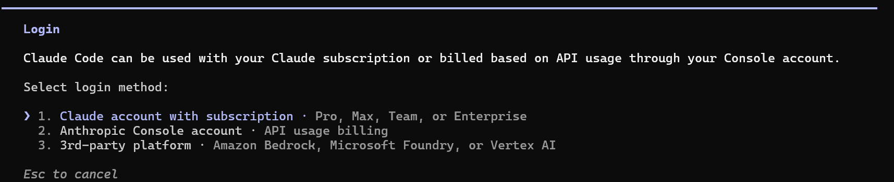

# 快速入门 {#quickstart}

从零开始，大约 5 分钟内让 Cortex 智能体在聊天工具中回复你，其中大部分时间是在等待 `npm` 安装和填写聊天平台的应用创建页面。

Cortex 通过 Slack 或飞书（Lark）与你对话——任选其一，或同时运行两者。`cortex init` 几乎完成所有工作。你不需要手动编辑任何配置文件。本指南告诉你每个提示的预期内容，并精确指示界面中的操作位置。

## 不想用终端？ {#prefer-not-to-use-a-terminal}

[桌面应用](desktop-app.md#installing-a-server-from-the-app)可以在 macOS、Linux 和 Windows 上替你安装并配置 Cortex。选择**安装 Cortex**，等待安装与启动自动完成，再登录并选择默认 Profile。全新安装使用本机 hostname、端口 3004，不安装登录自启服务；已有机器、端口和服务设置会被保留。只有初始化、启动或连接失败才提供修复设置。Slack 与飞书设置会被跳过——应用本身就是交互界面。登录可能需要在浏览器中授权或完成 MFA；macOS 首次打开应用时可能需要 Gatekeeper 确认。

安装包自带 Node.js，Windows 安装包另含 Git Bash，因此不需要终端、另行安装的 Node.js 或 Git、Homebrew 或管理员权限。本机安装支持 macOS 13.5+、glibc 2.28+ 的 x86_64 Linux，以及 x86_64 的 Windows 10/11；详见桌面应用指南。以下内容介绍终端安装与聊天平台设置。

## 前置条件 {#prerequisites}

以下要求与命令适用于终端安装。

- **Node.js ≥ 22.19.0**，服务端内置 PI SDK 要求此版本或更高。
- **一个 Slack 工作区或一个飞书（Lark）组织**，你可以在其中创建应用。
- **大约 2 GB 空闲磁盘空间**，用于后端、插件和日志。

你**不需要**预先安装编程智能体。PI 引擎随 Cortex 服务器包一起打包。Claude Code 是可选项；选择其登录流程时，若尚未安装，会提供安装选项。macOS/Linux 不要求安装 Git。`cortex init` 创建目录和 env 文件，仅在已有可用 Git 时初始化版本历史。版本历史和 Git 来源的扩展需要 Git，Windows shell 工具需要 Git Bash。

### 检查 Node.js 版本 {#checking-your-nodejs-version}

打开终端，运行：

```bash
node --version
```

你应该看到类似 `v22.19.0` 的输出。如果版本低于 22.19.0，或看到 `command not found: node`，请使用以下方法安装或升级 Node.js。


### 安装 Node.js {#installing-nodejs}

**macOS（Homebrew）：**

```bash
brew install node@22
```

**Linux（nvm，推荐）：**

```bash
curl -o- https://raw.githubusercontent.com/nvm-sh/nvm/v0.40.3/install.sh | bash
# 重启终端，然后：
nvm install 22
nvm use 22
```

**Linux（apt，仅适用于软件源提供 Node ≥22.19.0 的系统）：**

```bash
sudo apt update && sudo apt install nodejs npm
```

**Windows：**

从 [nodejs.org](https://nodejs.org/) 下载 LTS 安装包（选择 ≥22.19.0 的 LTS 版本）。运行 `.msi` 安装程序并按提示操作。安装完成后重启终端。

验证安装：

```bash
node --version   # 必须输出 v22.19.0 或更高版本
npm --version    # 应输出 10.x.y 或更高
```

## 第一步 — 安装 Cortex {#step-1-install-cortex}

```bash
npm install -g @cortex-agent/server
```

这会在你的 PATH 中放置 `cortex` 命令，以及三个辅助命令：`cortex-signal`、`cortex-hook` 和 `cortex-evidence-export`。

如果 `npm install -g` 因权限错误而失败（Linux 上常见），请加 `sudo`，或更好的做法是配置 npm 使用用户本地前缀：

```bash
mkdir -p ~/.npm-global
npm config set prefix ~/.npm-global
echo 'export PATH=~/.npm-global/bin:$PATH' >> ~/.bashrc
source ~/.bashrc
npm install -g @cortex-agent/server
```

## 第二步 — 运行设置向导 {#step-2-run-the-setup-wizard}

```bash
cortex init
```

向导会遍历以下提示。默认值都是合理的；按回车接受即可。以下是每个提示的作用及如何回答。

### 2.1 选择语言 {#21-which-language}

```
Select language / 选择语言
❯ English
  中文 (Simplified Chinese)
```

第一个提示选择 Cortex 用于系统生成消息以及本向导其余部分的语言。它默认采用你的系统区域设置，所以中文系统会预选 中文。该选择会保存到 `config/preferences.json`，之后可通过 `!lang` 命令更改。

### 2.2 内置 PI 与可选 Claude Code {#22-which-backends}

交互式 `cortex init` 默认使用 **PI**，不询问后端选择。PI 随 Cortex 一起打包，只需配置 Provider 凭据，无需单独安装。继续填写平台与机器设置；配置文件写入后，再进入[第 2.10 节](#210-auto-detect-backends-for-gatewayprofiles)的凭据检测与登录。

**Claude Code** 是可选项，与 PI 中的 Anthropic Provider 相互独立。在登录步骤选择 Claude Code 时，会复用已有安装，或在缺失时询问是否允许安装。

### 2.3 选择交互平台 {#23-which-interaction-platforms}

```
? 你想使用哪些交互平台？（空格切换，回车确认，留空跳过）
❯ ◯ Slack（推荐）
  ◯ Feishu (飞书)
```

这是一个多选项。用空格切换，回车确认。可以选 **Slack**、**飞书**，或两者都选——Cortex 会组合你选择的平台并同时连接到所有平台。你选择的每个平台都会触发各自的凭据收集步骤（先 Slack，后飞书）。

留空则跳过平台设置。稍后可编辑 `$CORTEX_HOME/config/.env` 来配置某个平台，然后重启服务器。

### 2.4 Slack 应用设置（在浏览器中逐步操作） {#24-slack-app-setup-step-by-step-in-the-browser}

如果你没有选择 Slack，跳过本节。

Cortex 首先打印完整的 **Slack 应用清单**，并询问是否要复制到剪贴板。按 **c** 键 — 清单 JSON 现在已复制到剪贴板。


#### a) 打开 Slack API 应用页面 {#a-open-the-slack-api-apps-page}

前往 **[https://api.slack.com/apps](https://api.slack.com/apps)**。


#### b) 从清单创建新应用 {#b-create-a-new-app-from-manifest}

点击绿色的 **Create New App** 按钮，然后点击 **From a manifest**。如果还没有工作区，需要先创建一个。


#### c) 选择工作区并粘贴清单 {#c-pick-your-workspace-and-paste-the-manifest}

1. 从下拉菜单中选择你的 Slack 工作区。
2. 将清单 JSON 粘贴到文本区域（Ctrl+V / Cmd+V）。清单已由 `cortex init` 复制到剪贴板，直接粘贴即可。
3. 点击 **Next**。
4. 查看摘要后点击 **Create**。


#### d) 复制 Signing Secret {#d-copy-the-signing-secret}

创建完成后，Slack 会将你带到应用的 **Basic Information** 页面。在 **App Credentials** 下方，找到 **Signing Secret**。点击 **Show** 并复制。

回到终端，将其粘贴为 `SLACK_SIGNING_SECRET`。


#### e) 生成 App-Level Token（xapp-…） {#e-generate-the-app-level-token-xapp-}

在同一 **Basic Information** 页面向下滚动到 **App-Level Tokens** 部分。点击 **Generate Token and Scopes**。

- Token Name：`cortex-socket`
- Add Scope：`connections:write`
- 点击 **Generate**

复制出现的令牌（以 `xapp-` 开头）。注意：令牌只显示一次，请立即复制。

回到终端，将其粘贴为 `SLACK_APP_TOKEN`。


#### f) 安装到工作区并复制 Bot Token（xoxb-…） {#f-install-to-workspace-and-copy-the-bot-token-xoxb-}

在左侧边栏中点击 **OAuth & Permissions**。滚动到 **OAuth Tokens** 部分，点击 **Install to Workspace**。在授权页面上点击 **Allow**。

安装完成后，页面顶部会显示 **Bot User OAuth Token**（以 `xoxb-` 开头）。复制它。

回到终端，将其粘贴为 `SLACK_BOT_TOKEN`。


#### g) 启用 Messages Tab {#g-enable-the-messages-tab}

在左侧边栏中点击 **App Home**。向下滚动到 **Show Tabs** 部分：

- 勾选 **Messages Tab**（使其出现在机器人的 App Home 中）。
- 勾选 **Allow users to send Slash commands and messages from the
  messages tab**（以便你可以给机器人发私信）。

如果不勾选此项，你可以在频道中 `@cortex` 机器人，但无法给它发私信。


#### h) 管理频道 {#h-admin-channel}

Cortex 会把启动通知、审批请求和其他运维消息发送到管理频道。设置过程中无需输入任何内容——Cortex 会在你第一次给机器人发私信时自动检测管理频道并持久化。

如果你想把管理消息发送到指定频道（例如共享的运维频道），从 Slack 获取频道 ID（右键点击频道名称 → View channel details → 在对话框底部复制 Channel ID），然后在 `$CORTEX_HOME/config/settings.json` 中设置 `adminChannel` 键（见 [configuration.md](./configuration.md#configsettingsjson)）。`.env` 中的旧变量 `SLACK_ADMIN_CHANNEL` / `CORTEX_ADMIN_CHANNEL` 仍作为已弃用的回退可用。

### 2.5 飞书应用设置（在浏览器中逐步操作） {#25-feishu-app-setup-step-by-step-in-the-browser}

如果你没有选择飞书，跳过本节。Cortex 会打印设置指南，然后收集你的应用凭据。

#### a) 创建飞书应用 {#a-create-a-feishu-app}

前往 **[https://open.feishu.cn/app](https://open.feishu.cn/app)**，点击 **创建 agentic 应用**（Create Agentic App）。输入应用名称（例如 `CortexAgent`），选择头像，然后点击 **创建**。


#### b) 复制 App ID 和 App Secret {#b-copy-the-app-id-and-app-secret}

创建后，应用页面会显示 **App ID** 和 **App Secret**。复制它们。


回到终端，在 `FEISHU_APP_ID` 和 `FEISHU_APP_SECRET` 提示处粘贴。

#### c) 订阅消息事件 {#c-subscribe-to-message-events}

在应用的事件配置中，启用机器人事件并订阅 **`im.message.receive_v1`**。如果不订阅，机器人永远收不到你的消息。

#### d) 域名（可选） {#d-domain-optional}

```
? FEISHU_DOMAIN（可选，"feishu" 或 "lark"）：
  feishu（留空使用默认值）
```

输入 `feishu` 使用飞书（中国大陆）域名，或输入 `lark` 使用国际 Lark 域名。留空则使用默认值。

#### e) 文档操作的身份 {#e-identity-for-document-operations}

```
? MCP 文档操作的身份：
  bot   —— 文档由应用拥有
❯ user（推荐）—— 文档由你的飞书账号拥有
```

Cortex 的 MCP 工具可以创建和编辑飞书文档（docx、wiki、bitable、sheets、drive）。此提示决定这些文档的归属。选择 **bot** 使应用成为拥有者。选择 **user** 使你自己的飞书账号成为拥有者，文档会保留在你的个人空间中——这是推荐选项。

如果选择 **user**，`cortex init` 会立即运行飞书用户登录（OAuth 设备流程），让你一次性完成授权。它会打印一个 URL——在任意浏览器中打开，批准访问，Cortex 会自动轮询获取令牌，无需重定向 URI。如果你跳过或中止登录，凭据仍会被保存，之后可用 `cortex feishu login` 完成授权。

### 2.6 机器名称 {#26-machine-name}

默认为你的主机名。除非你想要自定义标签，否则直接按回车。

### 2.7 GPU 检测 {#27-gpu-detection}

Cortex 运行 `nvidia-smi` 并打印数量。无需输入。如果没有 NVIDIA GPU，它会打印 0 — 对于大多数使用场景完全没问题。

### 2.8 aistatus 令牌使用报告？ {#28-aistatus-token-usage-reporting}

可选。选择是会把你的 token 用量放到 [aistatus.cc 公开排行榜](https://aistatus.cc/leaderboard)上，排行榜显示你的名称、组织和 token 数。需要填写名称和邮箱，组织可选；邮箱只用于识别身份，不会公开显示。

桌面应用的 Provider 设置页也以可选的**公开用量排行榜**卡片提供同一选项，之后可随时在**设置 → 用量**中开启或关闭。关闭后会保留已填写的名称、组织和邮箱，再次开启时沿用。

### 2.9 注册为系统服务？ {#29-register-as-a-system-service}

- **macOS** — 在 `~/Library/LaunchAgents/cc.cortex.agent-server.plist` 创建 `launchd` plist。运行打印的启用命令后，守护进程会在登录时自动启动。
- **Linux** — 创建 `systemd --user` 单元（无需 `sudo`）。运行打印的启用命令后，守护进程会在登录时自动启动。
- **Windows** — 不支持。需手动运行 `cortex daemon`。

### 2.10 检测凭据、登录并配置 Profile {#210-auto-detect-backends-for-gatewayprofiles}

写入配置文件后，Cortex 自动检测本地 Claude Code 与 PI 凭据。这是凭据检测，不是在线推理测试：不会发起付费推理请求，也不保证模型调用一定成功。

终端提供以下操作：

- **使用已配置的服务商继续**（Continue with configured providers）——使用检测到的凭据，从发现的端点配置 gateway 路由与 Profile。选择用于 `plan`（planner、doc-writer、coder 等执行智能体）和 `execute`（审查智能体）的（mode, model）对。
- **登录 / 安装并登录 Claude Code**（Login / install and login Claude Code）——选择后端、Provider 及其支持的 OAuth 或 API key 方式。PI 已内置；Claude Code 已安装时直接复用，只有选择其登录路径时才会询问是否安装缺失的程序。登录后返回凭据检测。
- **重新扫描凭据**（Rescan credentials）——读取在其他终端配置的凭据，再继续同步 gateway 路由与 Profile。
- **稍后配置**（Configure later）——完成初始化，同时警告：配置好凭据与 Profile 前，Agent 可能暂不可用。

也可直接从终端登录，无需运行 daemon：

```bash
cortex auth login
cortex auth login --backend pi --provider anthropic --auth-type api_key
cortex auth login --backend claude --provider anthropic --auth-type oauth
cortex auth status
```

登录要求交互式 TTY。密钥与授权响应通过提示输入，不能作为命令参数传入。命令将 JSON 结果写入 stdout，将面向人的提示与指引写入 stderr。`cortex auth login --help` 列出选项，详见 [CLI 参考](./cli-reference.md#commands)。

使用 `--answers <file>` 或 `--json` 时，init 检测凭据并报告状态，不会启动 Provider 登录或等待输入。省略 `backends` 时默认使用 PI；显式提供 `backends` 时保留所指定的后端选择与安装行为。即使尚未配置 Provider，这类运行也能完成。之后可用 `cortex auth login` 或**设置 → 账号**登录，再用 `cortex setup-gateway` 配置 Profile。Slack 或飞书中也可通过 `!login` 远程登录，参见[后端：远程登录](./backends.md#remote-login)。

### 2.11 后端登录过期怎么办 {#211-when-the-backend-login-expires}

后端凭据会在一段时间后过期。过期后智能体运行会失败并报认证错误，例如：

```
Failed to authenticate. API Error: 401 OAuth access token has expired.
Re-authenticate to continue.
```

使用 `cortex auth login` 重新登录，或使用 Slack/飞书中的 `!login` 或**设置 → 账号**。Claude Code 也支持 `claude` 加 `/login`。



Cortex 也会主动提醒。运行中的智能体一旦撞上认证过期，就会发出点名 provider 的通知卡，卡上带一键重登按钮；每日扫描还会对临近过期的凭据发出预警。

登录完成后，刷新的凭据会在下一次智能体运行时被识别。如果端点或模型发生了变化，重新运行 `cortex setup-gateway`，让 `plan` 与 `execute` 配置指向新的后端。

---

向导完成后你会看到：

```
Cortex initialized at /home/you/.cortex. Run `cortex daemon` to launch.
```

## `cortex init` 创建了什么 {#what-cortex-init-created}

所有内容都位于 `CORTEX_HOME`（默认 `~/.cortex/`）下：

```
~/.cortex/
├── .git/                       # 可选：已有可用 Git 时创建
├── AGENTS.md                   # 根智能体上下文（从默认值初始化）
├── config/
│   ├── .env                    # CORTEX_PLATFORM 列表 + 平台令牌 + CORTEX_MACHINE
│   ├── feishu-user-token.json  # 飞书用户身份令牌（仅当 FEISHU_AUTH_MODE=user 时）
│   ├── preferences.json        # 操作者界面语言
│   ├── budget.json             # 每日/每月预算限制
│   ├── machines.json           # 本机能力（gpuCount、路径）
│   ├── mcp-config.json         # 直接会话 MCP 服务器
│   ├── mcp-config-core.json    # 远程执行/时间分层
│   ├── mcp-config-interaction.json # 共享交互分层
│   ├── profiles.json           # 命名的（后端、模型）配置
│   ├── environments/           # 执行环境：main.json、creative.json
│   └── hooks/                  # 钩子注册表——每个钩子一个 JSON 声明
├── data/
│   ├── agent-state.json        # 活跃 profile、默认智能体、频道级 override
│   └── schedules.json          # 初始化的内置定时任务
├── context/                    # 项目日志存放在这里
│   ├── AGENTS.md、projects/、decisions/、scans/、ideas/、retrospectives/、user/
├── plugins/                    # 技能插件（默认值的完整副本）
├── prompts/                    # 指令、系统提示、模板
├── rules/                      # 智能体自动加载的规则文件
├── hooks/                      # 钩子脚本（.mjs）
├── .claude/                    # Claude Code 钩子 + 设置
└── logs/                       # 守护进程 + LLM 日志
```

正常使用时你**不应该**手动编辑任何这些文件。`cortex init --force` 会重置 `machines.json`、Agent 状态、语言偏好、计划任务和预算，并覆盖与内置资源同名的 prompts、rules、plugins、hooks 和决策模板。每次 init 都会重新生成 MCP 配置。对于 `.env`，init 只更新自身管理的设置，保留已有的客户端/ webhook token 和手动添加的键。已有的执行环境和脚手架文件会保留；替换已有 Profile 需要确认。使用 `--force` 前请备份自定义文件；添加平台不需要使用它。

`~/.aistatus/` 单独存放：

```
~/.aistatus/
├── gateway.yaml                # 网关路由配置（自动生成）
└── config.yaml                 # aistatus 上传器设置（你的姓名/组织/邮箱）
```

## 第三步 — 启动服务器 {#step-3-start-the-server}

```bash
cortex daemon         # 受监督运行，崩溃重启 + 热重载
# 或
cortex start          # 前台运行，Ctrl-C 停止
```

如果你在第二步 2.9 中选择了注册系统服务，init 会写入服务文件并打印启用命令。需要运行该命令才能启动服务：

```bash
# Linux 用户服务
systemctl --user enable --now cortex
# macOS
launchctl load ~/Library/LaunchAgents/cc.cortex.agent-server.plist
```

用 `cortex daemon status` 检查守护进程状态；`cortex config` 显示解析后的路径和初始化状态。

## 第四步 — 发送你的第一条消息 {#step-4-send-your-first-messages}

现在进入有趣的部分。打开 Slack 或飞书，找到你刚安装的 Cortex 机器人，发起私信（DM）。

### 4.1 打个招呼 {#41-say-hello}

给机器人发私信：

```
hello
```

第一条私信是 Cortex 用来自动检测管理频道的（除非你在 `config/settings.json` 中显式设置了 `adminChannel`）。你应该在几秒钟内收到回复。


### 4.2 创建你的第一个项目 {#42-create-your-first-project}

给 Cortex 一个使命。Cortex 会创建项目、设置目录结构并回复确认：

```
创建一个叫"天气看板"的项目，我想做一个显示我所在城市天气的简单网页看板
```

Cortex 会回复它创建的项目结构，以及它对使命的理解。


### 4.3 查看项目状态 {#43-check-project-status}

```
天气看板项目进展如何
```

Cortex 会读取项目的 `STATUS.md`、使命和最近的实验记录，然后给你一个当前状况的摘要。

当工作分给多个 worker 或要持续很多小时时，Cortex 会在 Web UI 里开一个看板：显示在对话旁边的状态页，展示任务的状态、计划和决策。你也可以直接要求开一个。参见[看板](./team.md#boards)。

## 接下来读什么 {#what-to-read-next}

- 创建 Slack 应用时出了问题，或想在运行 `cortex init` 之前先完成设置 — 阅读 [slack-setup.md](./slack-setup.md)。
- 想了解 Cortex 识别的每个配置文件和环境变量，或覆盖某个自动生成的路径 — 阅读 [configuration.md](./configuration.md)。
- 想了解每个 CLI 子命令和标志 — 阅读 [cli-reference.md](./cli-reference.md)。
- 想切换后端或添加其他提供商 — 阅读 [backends.md](./backends.md)。
- 想让 Cortex 把工作交给子智能体，或带领持久的 worker 会话 — 阅读 [backends.md](./backends.md#subagents) 和 [team.md](./team.md)。
- 想将远程机器连接到 Cortex — 阅读 [cross-machine.md](./cross-machine.md)。
- 想了解项目日志结构（实验、知识、模式）— 阅读 [memory.md](./memory.md)。
