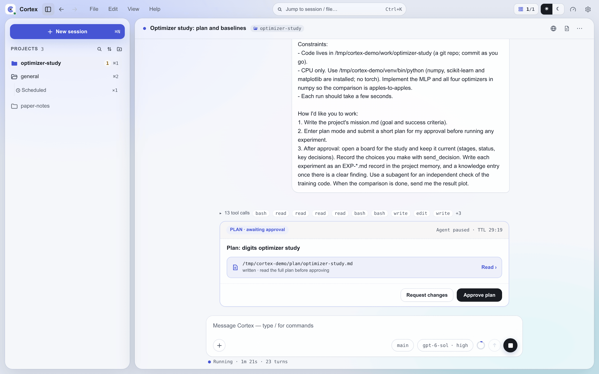

# 安全和审批 {#safety-and-approvals}

Cortex 可以编辑文件、启动进程、管理 GPU 训练，并与多台机器通信。它的安全模型由四部分组成：一份成文的安全边界，告诉智能体哪些事可以自主去做；一个审批队列，存放需要你签字确认的操作；用于计划审批和提问的交互卡片；以及围绕服务器自身接口的一小组机械防护。交互卡片依托 hook-bridge（参见 [hooks.md](./hooks.md)）和交互类 MCP 工具（参见 [mcp.md](./mcp.md)）运行。

## 三个影响范围等级 {#the-three-blast-radius-classes}

安全边界把智能体的操作划分为三个等级。它写在 Cortex 主目录的根 `AGENTS.md`（`$CORTEX_HOME/AGENTS.md`）里，每个会话都会加载，因此它是智能体遵循的指引，而不是服务器执行的检查。`cortex init` 生成的 `AGENTS.md` 不含安全部分，需要你用自己的话补上。最有效的判断标准是**行为影响**，而不是文件类别：修正技能文件里的拼写错误和往里面添加新的工作流步骤属于不同等级的操作，尽管两者改的是同一个文件。

下面是一份取自实际安装环境的典型边界。

### 自助（自主执行） {#self-serve-autonomous}

智能体无需询问即可执行的操作：只读的信息收集、本地状态更新和低风险维护。

- 读取文件、检查 GPU 状态、读取日志、运行小型测试脚本
- 更新上下文文件（STATUS.md、experiments/、knowledge/、OVERVIEW.md）
- 网络搜索、知识扫描
- 在预算内启动训练任务、运行分析脚本
- 技能维护性修改（修正拼写错误、对齐格式、润色描述文字——不改变行为）
- Agent-server 非行为性修复（语法错误、日志文案、注释更新）

### 需要审批（需要签字） {#needs-approval-requires-sign-off}

会改变系统行为、消耗大量资源或难以撤销的操作。智能体把它们写入审批队列，在你做出决定之前不会执行。

- 修改 AGENTS.md 或 CLAUDE.local.md
- 新建技能或修改技能的行为逻辑（新触发条件、新工作流步骤、能力扩展）
- Agent-server 的行为或架构变更（新功能、协议变更、API 变更）
- 超预算的训练任务、大规模架构修改
- 删除文件或数据
- 修改模型代码或训练配置
- 停止 Cortex 服务器或守护进程

### 禁止（永不允许） {#forbidden-never-permitted}

即使你表示愿意批准，智能体也会拒绝的操作：可能让机器失去稳定的系统级更改。

- 安装系统级软件包
- 修改系统配置
- `rm -rf`

### 边缘情况的归类 {#classifying-an-edge-case}

| 操作 | 等级 | 原因 |
|---|---|---|
| 修正技能 SKILL.md 中的拼写错误 | 自助 | 维护性修改，不改变行为 |
| 给技能添加新的工作流步骤 | 需要审批 | 改变行为逻辑 |
| 修复 agent-server 的语法错误 | 自助 | 非行为性修复 |
| 给 agent-server 添加新的防护逻辑 | 需要审批 | 改变行为 |
| 在预算内启动 GPU 训练 | 自助 | 在预算之内 |
| 修改 AGENTS.md 规则 | 需要审批 | 系统约定变更 |

这份边界只是建议性的。服务器不会在命令运行前做任何检查：Claude Code 以 `--dangerously-skip-permissions --permission-mode bypassPermissions` 启动，PI 运行工具时也不弹出权限确认。预算同样只是建议性的——`budget.json` 中的限额由 `cost_query` 和 UI 报告，任何调用方都不会因为超出限额而拒绝工作。边界之所以有效，是因为智能体每一轮都会读到它，而且下面的审批队列为它不该独自去做的事提供了去处。

## 操作如何进入队列 {#how-an-operation-reaches-the-queue}

审批队列是 Markdown 文件 `$CORTEX_HOME/context/PENDING_APPROVALS.md`。智能体判断某个操作需要签字确认时，会追加一个条目，并暂不执行该操作。每个条目是一个形如 `<YYYY-MM-DD> <title>` 的 `##` 标题，后接若干列表字段，细节足以让你无需追问即可做出决定：

```markdown
## 2026-10-14 Delete stale checkpoints on trainer
- **Operation**: Remove checkpoints older than 30 days under /data/ckpt
- **Reason**: The disk is 94% full and two runs are queued
- **Impact**: About 410 GB on trainer; no active run reads these files
- **Command/Action**: find /data/ckpt -mtime +30 -name '*.pt' -delete
- **Project**: nimbus
- **Status**: pending
```

`Project` 是可选字段；没有该字段的条目归入全局分组。还可以用一个自由格式的 `Provenance` 列表项记录请求的来源。指导原则是：拿不准时，就排队。

**Settings** 也会写入这个队列。在 **Settings** 中添加机器或重新连接聊天平台时，会排入一条请求（"Queued for approval — review in the Approval Center"），而不是直接在浏览器里执行变更。该文件在写入第一个条目时创建。

## 你如何批准或拒绝 {#how-you-approve-or-reject}

### 在 Approval Center 中 {#in-the-approval-center}

在桌面端，只要队列中有待处理的条目，左侧栏就会出现一个琥珀色胶囊标签（"2 approvals pending"），点击即可打开 Approval Center。在手机上，同一个队列就是 Approvals 页面。条目按项目分组，未指定项目的条目归在 GLOBAL 下，每个条目都会显示其操作、原因、影响和命令。

在这里批准或拒绝，会改写条目的 `Status` 行——写成 `approved <date>`，或在你附带反馈时写成 `rejected <date> (<feedback>)`——文件中的其他行保持不变。Approval Center 只记录你的决定，既不执行操作，也不给会话发消息。操作由下一个处理该队列的智能体执行。

### 通过 approval 技能 {#through-the-approval-skill}

`approval` 技能（位于内置的 `cortex-system` 插件中）可以在任何平台上于对话里处理队列。你可以让智能体展示待审批项，也可以直接调用该技能。它会给待处理条目编号列出，并响应 `approve 1`、`approve all`、`approve 1 3`、`reject 2` 或 `approve 1 but change X to Y` 这类回复。对于已批准的条目，智能体会执行操作、验证结果并记录下来。

### 之后会发生什么 {#what-happens-after}

| 结果 | Status 行 | 智能体的行为 |
|---|---|---|
| 通过技能批准 | `approved — executed <timestamp>` | 执行操作并报告结果 |
| 在 Approval Center 中批准 | `approved <date>` | 在有智能体处理该决定之前不做任何事 |
| 拒绝 | `rejected <timestamp>`，可附带反馈 | 不执行；可能提出替代方案 |
| 执行失败 | `failed — <reason>` | 报告失败并保留该条目 |

已处理的条目会留在文件中，作为决策历史。Approval Center 也会把以 `resolved`、`deferred` 或 `superseded` 开头的状态视为已决定，因此手动关闭的条目不会计入待处理。

## 计划审批与提问 {#plan-approval-and-questions}

有两种交互会让智能体暂停，直到有人回应：审批一份写好的计划，以及回答一个问题。两者都是交互工具包中的 MCP 工具，用户发起的会话在两种后端上都会加载它们（参见 [mcp.md](./mcp.md#cortex-interaction-bridge)）。

### 计划模式 {#plan-mode}



`cortex_plan_enter` 让智能体进入 Cortex 的计划流程：以只读方式调研，把计划写入 `plan/` 下的文件，在计划获批之前不做任何实现。后端原生的计划工具被禁用，因此所有计划都走同一条审批路径，并留在对话历史中。

`cortex_plan_exit` 提交计划文件以供审批，并阻塞直到你做出决定：

1. 工具读取 `plan_file_path`，把计划 POST 到服务器回环地址上的 webhook `/hook/exit-plan-mode`。
2. hook-bridge（`agent-server/src/orchestration/routing/hook-bridge.ts`）以 30 分钟 TTL 注册该请求，并在事件总线上发布 `plan.submitted`。
3. 订阅者（`agent-server/src/orchestration/routing/hook-bridge-subscribers.ts`）登记该计划，并在会话所在平台上展示它。
4. 你的回应会了结这个挂起的请求：
   - **Approve** → 工具返回批准结果，发布 `plan.approved`，智能体继续执行。
   - **Reject with feedback** → 工具返回你的反馈，并告知智能体修改计划后重新提交。

### 提问 {#questions}

`cortex_ask_user` 提出一个或多个问题——单选、多选或自由文本——并可指定严重级别 `level`（`info`、`warning`、`error`）。它 POST 到 `/hook/ask-user-question`，bridge 发布 `ask-user.requested`，订阅者随即展示表单。

阻塞式提问（默认）会让工具调用一直挂起，直到你作答，并在自身结果中返回答案。设置 `blocking: false` 时，卡片一贴出调用就返回，智能体继续工作；你的答案稍后作为一条普通用户消息送达会话，如果当前轮次仍在进行，就并入该轮。无人回答的非阻塞卡片按同样的 TTL 过期，不会产生任何消息。

### 卡片出现在哪里 {#where-the-cards-appear}

| 平台 | 计划审批 | 提问 |
|---|---|---|
| Web UI 和桌面端 | 聊天中的内联卡片，带 **Approve plan** 和 **Request changes**；请求修改必须填写反馈，计划会退回重新规划 | 内联表单；点击 **Submit answers** 后智能体继续 |
| 移动端 | 同样的卡片，按手机布局排版 | 同样的表单 |
| Slack | 先发计划文本，再发一张带 **Approve** 和 **Provide Feedback** 的卡片；反馈会打开一个模态框 | 一段摘要加一个 **Answer** 按钮，点击打开模态表单 |
| Feishu | 先发计划文本，再发一张带 **Approve** 和 **Provide Feedback** 的卡片；反馈会打开一个内联表单 | 表单以内联方式发在聊天中 |

在 Web UI 上，卡片是对话记录的一部分，因此它的结果——已批准、已拒绝、已回答、已过期或已取消——在刷新后和其他设备上都依然可见。无论回应来自哪里，以第一个为准。因计划或阻塞式提问而挂起的会话，会在会话列表中显示琥珀色标记，这是唯一表示"等你处理"的标记；非阻塞提问不会改变会话的运行中标记。

### 团队模式 {#team-mode}

[团队 worker](./team.md) 提问或提交计划时，仍会显示自己的卡片，同时请求也会转发给它的 lead，lead 可以用 `worker_answer` 作答。无论答案来自 lead，还是来自你在 worker 卡片上的回应，都以第一个为准。在 lead 持有该请求期间，worker 显示为在等待它的 lead，而不是在等你。

### 超时 {#timeouts}

挂起的计划或提问在 30 分钟后过期（bridge 每 5 分钟清扫一次，所以实际过期时间在 30 到 35 分钟之间）。此时阻塞调用向智能体返回超时；如果是计划，智能体会被告知修改后重新提交。在 Web UI 上，卡片被标记为已过期。

### PI 扩展对话框 {#pi-extension-dialogs}

在 PI 上，`cortex_ask_user` 和 `cortex_plan_exit` 的行为与上文完全一致；交互工具在进程内运行。PI 扩展还可以通过 PI 的扩展 UI 打开自己的对话框（select、confirm、input）。Cortex 在服务器内部承载这个 UI（`agent-server/src/agent-adapter/pi/ui-context.ts`）：每个对话框成为一条带自身 id 的 `extension_ui_request` 记录，通过 hook-bridge 的发布辅助函数以问题卡片的形式展示，答案经 `sendExtensionUiResponse()` 回传。

## 各部分以什么权限运行 {#what-runs-with-which-privileges}

Cortex 以启动它的用户的权限运行。它没有自带任何提权路径，也没有提供沙箱：之所以设置禁止等级，正是因为否则智能体可以做该账户能做的任何事。

服务器自身的接口有机械防护：

- MCP 工具和 hook 脚本调用的 webhook 监听器（`WEBHOOK_PORT`，默认 3001）只绑定 `127.0.0.1`，且每个路由都要求在 `x-cortex-token` 请求头中携带 `CORTEX_WEBHOOK_TOKEN` bearer token。唯一的例外是 `/webhook/signal`，它用限定于单个 [waitpoint](./waitpoints.md#security) 的 secret 对每个请求做认证。
- 每个 `cortex-client` WebSocket 连接都必须出示 `CORTEX_CLIENT_TOKEN`；缺少 token 或 token 错误时以 HTTP 401 拒绝。两个 token 在缺失时都会生成到 `$CORTEX_HOME/config/.env` 中。远程客户端以启动它的用户身份运行。参见 [cross-machine.md](./cross-machine.md#security-boundary)。
- `status-md-guard` hook 会拒绝让项目的 `STATUS.md` 或 `ISSUES.md`、或某个记忆 `AGENTS.md` 索引超出大小上限的编辑（参见 [hooks.md](./hooks.md#hook-scripts)）。

## 审计记录 {#audit-trail}

审批和交互在四个地方留下记录：

1. **PENDING_APPROVALS.md** — 每个排队的操作及其完整细节和最终状态。这是人类可读的决策历史。
2. **对话记录** — Web UI 的计划卡片和提问卡片连同其结果和反馈一起保存在会话历史中。
3. **事件日志** — `plan.submitted`、`plan.approved` 和 `ask-user.requested` 与事件总线上的其他事件一起写入按日划分的 `$CORTEX_HOME/logs/events/events-YYYYMMDD.jsonl` 文件，保留 14 天。设置 `CORTEX_EVENT_LOG=off` 可关闭该日志。
4. **Slack 和 Feishu** — 每次交互都会在频道中留下一条可见消息。

## 配置 {#configuration}

安全边界就是你在 `$CORTEX_HOME/AGENTS.md` 中写下的那一节。审批队列是 `$CORTEX_HOME/context/PENDING_APPROVALS.md`。两者都无需额外配置：智能体把边界作为指令的一部分读取，而审批队列、Approval Center 和交互卡片都是内置的。
