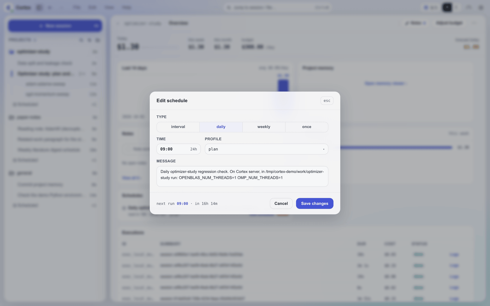

# Cortex 调度系统 {#cortex-scheduling-system}

调度系统用于设置周期性或一次性的智能体调用。调度持久化到磁盘，重启后依然保留，被外部修改时会热重载。每次触发都会新开一个会话来运行调度的提示。Provider 用量采集和记忆索引重建等 daemon 基础设施循环由下文介绍的内置作业控制器运行，不使用调度记录。

!!! tip "在等某件事结束？别用调度去轮询"
    只为检查任务是否完成而触发的调度，每次都要花掉一整轮 agent，而其中几乎每一轮
    都一无所获。改用 [waitpoint](./waitpoints.md)：任务结束时自己回报，
    session 恰好被唤醒一次。调度用于该按时钟发生的工作，而不是用来盯着别的东西。

## 调度类型 {#schedule-types}

支持四种触发类型：

| 类型 | 描述 | 关键参数 | 示例 |
|------|-------------|---------------|---------|
| `interval` | 每 N 个时间单位触发一次 | `interval`（如 `"5m"`、`"1h"`、`"30s"`） | 每 5 分钟运行一次状态检查 |
| `daily` | 每天在固定时间触发 | `time`（`HH:MM` 24 小时制） | 每天 09:00 运行每日摘要 |
| `weekly` | 每周在固定的某天某时触发 | `dayOfWeek`（0-6，0=周日）、`time` | 每周一 21:00 运行周回顾 |
| `once` | 延迟一段时间后触发一次 | `delay`（时长字符串） | 2 小时后发送提醒 |

时长字符串的格式为 `<number><unit>`，其中 unit 为 `s`（秒）、`m`（分钟）、`h`（小时）或 `d`（天），不区分大小写，数字可以带小数部分。示例：`"30s"`、`"5m"`、`"1.5h"`、`"1d"`。不带单位的数字字符串会被拒绝，所以 `"30"` 绝不会被当成 30 毫秒；传 JSON 数字的调用方（如 Web UI）给的是毫秒。星期写作 `sun`..`sat`（不区分大小写）或 `0`-`6`，时间为服务器本地时间的 24 小时制 `HH:MM`，小时必须是两位（写 `09:00`，不写 `9:00`）。消息会去掉首尾空白，且不能为空。

## 管理调度 {#managing-schedules}



所有入口使用同一套校验，写同一个 `schedules.json`：

| 入口 | 使用者 |
|-------------|-------------|
| `schedule` skill → `cortex schedule` | 会话内的智能体（见[智能体工作流](#agent-workflow)） |
| `cortex schedule` | 脚本和终端（见 [CLI](#cli)） |
| `!schedule` | Slack 或飞书里的聊天命令（见[聊天命令](#chat-commands)） |
| Web UI / 桌面端 | 调度列表和编辑器；可设置除 `preCheck` 外的所有字段，`once` 调度的时间在创建后固定 |

## 调度记录 {#schedule-records}

每个调度以 JSON 对象的形式存储在 `~/.cortex/data/schedules.json` 中：

```json
{
  "tasks": [
    {
      "id": "d6f1bb1e",
      "type": "interval",
      "message": "Check the active projects and report blockers",
      "projectId": "general",
      "profile": "claude-haiku",
      "intervalMs": 3600000,
      "createdAt": 1747680000000,
      "nextRun": 1747683600000,
      "lastRun": 1747680000000
    }
  ]
}
```

### ScheduleTask 字段 {#scheduletask-fields}

| 字段 | 描述 |
|-------|-------------|
| `id` | 8 字符十六进制标识符（自动生成） |
| `type` | `interval`、`daily`、`weekly` 或 `once` |
| `message` | 调度触发时发送的提示（触发时自动加上 `[Scheduled Task]` 前缀） |
| `projectId` | 调度所属的项目；每次触发的会话都在这个项目中打开 |
| `profile` | 智能体 profile 名称。未指定时，保存创建时的默认 profile，因此之后更换默认 profile 不会影响已有调度 |
| `intervalMs` | `interval` 类型：两次触发之间的毫秒数 |
| `time` | `daily`/`weekly` 类型：`HH:MM` 24 小时制时间 |
| `dayOfWeek` | `weekly` 类型：0-6（0=周日） |
| `runAt` | `once` 类型：触发时刻的纪元毫秒数 |
| `nextRun` | 计算得出的下一次触发时刻（纪元毫秒） |
| `createdAt` | 调度创建时刻（纪元毫秒） |
| `lastRun` | 最近一次交给 runner 的触发时刻（纪元毫秒），包括因上一次运行尚未结束或 profile 被限速而被 runner 跳过的触发。`once` 调度在触发时即被删除，从不记录该字段 |
| `lastSkipped` | 最近一次被跳过的触发时刻（纪元毫秒，preCheck 失败） |
| `isPaused` | 调度当前是否暂停 |
| `pausedAt` | 暂停时刻（纪元毫秒） |
| `pausedBy` | 调度暂停期间为 `"user"` |
| `dispatchType` | 保留的内部处理器键；普通用户调度不填写 |
| `preCheck` | 可选的 shell 命令；非零退出 → 跳过此次触发 |
| `idempotencyKey` | 由 `cortex schedule add --idempotency-key` 写入；用同一个 key 重试会返回这个调度 |

## 内置周期作业 {#built-in-periodic-jobs}

Provider 用量采集和记忆索引重建是 daemon 自有的作业。它们不会出现在 `schedules.json`、`!schedule list`、`cortex schedule list` 或 Web 调度列表中。它们的开关和间隔是 `config/settings.json` 中的两组键：`providerUsageCollectionEnabled` / `providerUsageCollectionIntervalMs`（默认开启，每 5 分钟一次）和 `memoryIndexRegenEnabled` / `memoryIndexRegenIntervalMs`（默认开启，每 24 小时一次）。记忆索引这一组也可以在 **Settings → Advanced → Built-in jobs** 中设置。

已启用的作业会在 daemon 启动时运行一次。设置修改会热重载：禁用作业会清除它的下一个 timer，启用作业会立即运行一次，修改间隔会重新安排下一次空闲运行。默认值和取值范围见 [configuration.md](./configuration.md#configsettingsjson)。

## 触发后在哪里运行 {#where-a-fire-lands}

每次触发都会新开一个普通会话——与你在 Web UI 或桌面端新建的会话相同——并把调度的消息加上
`[Scheduled Task]` 前缀作为它的第一轮发送。该会话被记为这个调度的一次运行，并以消息的前
60 个字符作为标题。触发从不复用之前运行的会话，因此周期性调度的每次运行各有独立的记录。

在工作台中，会话栏的 **Scheduled** 分组为每个调度显示一行。周期性调度的那一行打开其运行列表；
`once` 调度的那一行打开它的那次运行。回复某次运行会把它变成普通对话，随后移入常规的会话时间线。

会话在调度的 `projectId` 中打开，该项目在创建调度时确定。`cortex schedule` 和 Web UI
直接接受项目参数，默认为 `general`。智能体通过 `--project` 显式传入目标项目；`!schedule`
使用创建所在频道登记的项目，否则使用 `general`。如果触发时该项目已不存在，会话会在消息中
提到的项目中打开，否则在 `general` 中打开。

## PreCheck {#precheck}

`preCheck` 字段是一个可选的 shell 命令，起门控作用：如果命令以非零状态退出，该周期的调度触发会被**跳过**。调度按正常节奏安排到下一个周期——不会快速重试。

命令在 shell 中运行，不阻塞事件循环，超时为 15 秒。它会收到 `PRECHECK_LAST_RUN` 环境变量（任务 `lastRun` 字段的纪元毫秒数）。工作目录为 `DATA_DIR`（`~/.cortex/`）。

**preCheck 的使用场景：**

- 运行前检查必需的文件是否存在：`test -f ~/.cortex/data/schedules.json`
- 检查某个进程是否在运行：`pgrep -f "python train.py"`
- 检查系统负载：`[ $(cat /proc/loadavg | cut -d' ' -f1 | cut -d. -f1) -lt 8 ]`

## 热重载 {#hot-reload}

只有 daemon 的调度器会触发调度。daemon 与 `cortex schedule` 共用持久化的记录；CLI
直接写入 `schedules.json`。调度器用 `fs.watch` 监视这个文件，在最后一次变更 300ms 后：

1. 绕过内存副本，从磁盘读取文件
2. **移除**已不在文件中的任务的 timer
3. **添加**新任务的 timer
4. **重新设置**调度配置有变化的任务（通过比较配置哈希检测）
5. 发送管理通知：`🔄 schedules.json hot-reloaded: +N -M ~P task(s), T total`

调度器自己的写入同样会触发监视器；随后的重载发现没有变化，不发通知。每次写入（包括 daemon
自己的）都会在写入过程中重新读取文件，因此其他进程刚做的修改会被保留，不会被过期副本覆盖。

### 用于变更检测的配置哈希 {#config-hash-for-change-detection}

每个任务中与调度相关的字段会被哈希：`type`、该类型对应的时间字段（`intervalMs`、`time`、`dayOfWeek`、`runAt`）、`message`、`projectId`、`profile`、`dispatchType`、`preCheck`，以及是否暂停。如果文件中某个任务的哈希与当前已设置的不同，就重新设置它的 timer，因此任何写入方所做的编辑、暂停或恢复都无需重启即可生效。

## 运行中保护 {#in-flight-protection}

如果调度触发时它的上一次运行仍在进行，这次触发会被跳过，以防同一调度的运行相互重叠。被跳过的触发仍记为该调度的 `lastRun`，下一次触发按正常时间进行。

## 暂停和恢复 {#pause-and-resume}

### 暂停 {#pausing}

`interval`、`daily` 和 `weekly` 类型的调度可以暂停。暂停或恢复 `once` 调度会被拒绝并报错；它要么触发，要么被移除。

暂停时：
- `isPaused` 设为 `true`，`pausedAt` 记录时间戳，`pausedBy` 记录 `"user"`
- `nextRun` 设为 `null`
- 清除内存中的 timer，且不会重新设置

暂停的调度会一直保持暂停，直到被恢复。暂停一个已暂停的调度、或恢复一个正在运行的调度，都不会产生任何变化。

### 恢复 {#resuming}

恢复时：
- `isPaused` 设为 `false`，清除 `pausedAt` 和 `pausedBy`
- 根据调度类型重新计算 `nextRun`（`interval`：`now + intervalMs`；`daily`/`weekly`：下一次出现的时间）
- 重新设置 timer

### 移除 {#removing}

调度可以按 ID 删除。timer 被清除，条目从 `schedules.json` 中移除。移除是幂等的：对不存在的 id，`cortex schedule remove` 报告 `"removed": false`，Web UI 和 `!schedule remove` 则报告找不到该调度。

## 启动行为 {#startup-behavior}

服务器启动时，调度器：

1. 丢弃逾期超过 1 分钟（已过其 `runAt`）的 `once` 任务，
   并为每个任务发送一条管理通知：`Schedule <id> skipped (<n>s overdue): <message>`
2. 按计算出的 `nextRun` 时间安排其余所有任务。若某个 `interval` 任务的
   `nextRun` 在服务器停机期间已过，它会立即触发；停机期间错过的 `daily` 或 `weekly`
   触发不会补跑，而是安排下一次出现的时间
3. 启动用于热重载的文件监视器
4. 记录任务总数

## 智能体工作流 {#agent-workflow}

`schedule` skill 用 `cortex schedule` 完成所有调度操作。CLI 在 Cortex 服务器上使用其
`CORTEX_HOME` 运行，不会从调用它的会话或频道推断项目。智能体使用用户显式指定的项目，或从
会话上下文或 `cortex_context` 解析出会话所属项目，然后在添加调度时传入 `--project <id>`。
如果用户要求使用当前项目但取不到项目，应询问用哪个项目，而不是回退到 `general`。不能保证
Bash 带有会话专属的环境变量，在 PI 上也是如此。不传 `--profile` 时使用配置的默认 profile，
它可能与当前会话的 profile 不同。

每条消息都必须自包含：触发的会话需要知道项目、run、机器和文件路径，而不是引用创建调度时的对话。

每日和每周的时间使用服务器本地时区。先把用户时区下的请求换算为服务器时区，再设置 `--time`，
每周调度还要设置 `--day`；报告 `nextRun` 时换算回用户时区。要核实 daemon 实际使用的时区，
包括任何 `TZ` 覆盖。调度不支持单独设置时区；两地夏令时切换不同步时，用户当地的周期触发时间
可能发生偏移。换算不确定时先澄清，在有影响时说明这一限制。

## CLI {#cli}

`cortex schedule` 在智能体会话、终端或脚本中管理同一批调度。它的子命令有 `list`、`get`、`add`、`edit`、`pause`、`resume` 和 `remove`。所有命令都输出带 ISO 时间戳的 JSON，时间参数全部由显式 flag 给出，较长的提示可以从 stdin 读入：

```bash
cortex schedule add --type daily --time 09:00 --project nimbus --message "Summarize yesterday's sessions"
echo "Check training run r42 on trainer" | cortex schedule add --type once --delay 2h --message -
cortex schedule list --project nimbus
cortex schedule get a1b2c3d4
cortex schedule edit a1b2c3d4 --time 10:30
cortex schedule pause a1b2c3d4
cortex schedule remove a1b2c3d4 --dry-run
```

与调度类型不符的时间 flag 会被拒绝，`edit` 也不能修改类型；对 `once` 调度执行 `edit --delay` 会把触发时间设为当前时间加上该延迟。正在运行的 daemon 会在一秒内应用变更。全部选项见 [cli-reference.md](./cli-reference.md)。

## 聊天命令 {#chat-commands}

`!schedule` 命令在 Slack 或飞书中管理调度。在这里添加的调度属于该频道登记的项目，否则属于 `general`。

| 命令 | 描述 |
|---------|-------------|
| `!schedule` / `!schedule list` | 列出所有调度及其状态和下次运行时间。前十个调度附带按钮：周期性调度为 **Pause** 或 **Resume**，`once` 调度为 **Remove** |
| `!schedule add interval <duration> [--profile <name>] <message>` | 每隔一段时间重复（`--profile` 紧跟在时间参数之后） |
| `!schedule add daily <HH:MM> [--profile <name>] <message>` | 每天在固定时间运行 |
| `!schedule add weekly <day> <HH:MM> [--profile <name>] <message>` | 每周在固定的某天运行 |
| `!schedule add once <duration> [--profile <name>] <message>` | 延迟一段时间后运行一次 |
| `!schedule pause <id>` | 暂停周期性调度 |
| `!schedule resume <id>` | 恢复已暂停的调度 |
| `!schedule remove <id>` | 移除调度 |

## 执行路由 {#execution-routing}

普通调度记录使用 `scheduled-task` runner：每次触发新开一个会话，并发送带 `[Scheduled Task]` 前缀的消息。记录也可以在 `dispatchType` 中指定一个内部处理器；已注册的键为 `auth-expiry-scan` 和 `sync-public`，未注册的 `dispatchType` 会记录日志并跳过，不会被当作 agent prompt 解释。daemon 自有的周期基础设施使用内置作业控制器，不经过调度持久化。

## 速率限制 {#rate-limits}

当调度所用 profile 的所有配置都被限速时，这次触发会被跳过，调度保持原有的时间安排，到下一次时间再触发。跳过时会发出一条警告通知 `Schedule <id> skipped: all configs rate-limited.`；因其他原因（例如 profile 已不存在）无法启动的触发会发出一条错误通知。运行开始后才遇到限速的，会像其他会话一样被暂停并在之后恢复。
