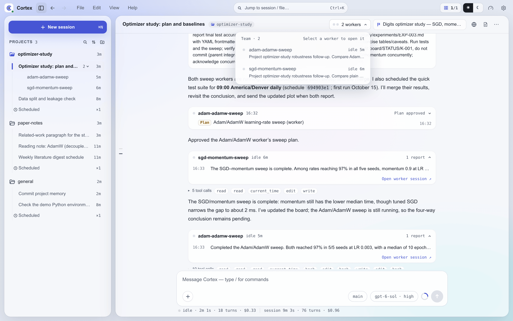
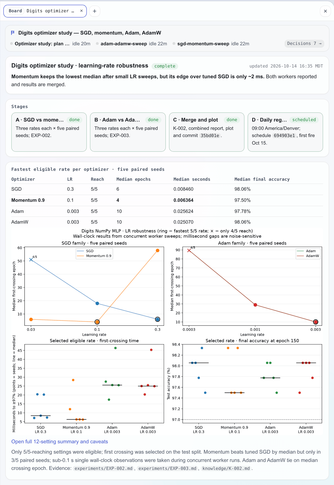

# 团队模式 {#team-mode}

团队模式让一个对话就能带一支团队。你只和一个会话对话，即**主会话（lead）**。它把工作交给若干持久的
**worker** 会话，之后可以让它们接着干，替你回答它们的问题，并告诉你结果。你不用为了给某件事一份独立
的上下文去新开会话，也不用操心哪个对话该接着做什么；这些由主会话负责。

团队模式是实验性功能，默认开启。可在 **设置 → 高级 → 团队（实验性）** 中关闭，或在 `settings.json`
里把 `teamEnabled` 设为 `false`（`CORTEX_TEAM_ENABLED=0`）。

## 主会话与 worker {#leads-and-workers}

团队模式开启后，每个网页会话都能当主会话。在真正创建 worker 之前，会话本身没有任何变化：没有 worker
的会话看起来、用起来都和普通会话一样，唯一的区别是工具列表里多了一组 `worker_*` 工具。

worker 是隶属于某个主会话的普通会话。它有自己的 transcript、上下文和续跑历史，和其他会话一样可以跑在
Claude 或 PI 上，拥有完整的工具面，包括一次性的 `agent` 工具。它不能再创建自己的 worker，所以团队只有
一层。worker 继承主会话的项目，并复制其完整引擎选择：backend、provider、model、thinking 和 route。
主会话可以传 `backend` 和 `model`，格式与 `agent` 工具相同（PI 用 `provider/model[:thinking]`，Claude 用
裸模型 id）。同一后端只替换写出的部分；换后端时，如果 `models.json` 的默认选择属于目标后端，就使用它，
否则使用目标后端的第一个收藏及其记住的设置。两者都没有时创建失败，并提示先收藏该后端的模型。
显式改变 PI provider 时使用该 provider 的路由。Claude 主会话可以带 PI worker，反之亦然。
创建 worker 不会改变用户新对话的引擎选择。

主会话只在有多个任务（或可拆成多个任务）、或用户切换到新任务时才用 worker；单一任务留在主会话里做。
交出去的工作按后续需要来选 worker 还是一次性 `agent`：可能需要后续接续、运行时间长、或可能要来回沟通的
工作交给 worker；有边界的侦察或验证、结果马上就用的，交给 `agent`。工作分给多个 worker 或要持续很多小时
时，主会话还会开一个[看板](#boards)，让你一眼看清进展。

## 工作如何流转 {#how-work-flows}

```
你 ⇄ 主会话 ── worker_spawn / worker_send ───────────▶ worker
       ▲  ◀── worker 每一轮结束时的汇报 ─────────────┤
       │  ◀── 提问 / 计划审批通知 ───────────────────┤
       └──── worker_answer ─────────────────────────▶（挂起的请求被解决）
你 ──────────── 直接打开 worker 与它对话 ────────────▶ worker
```

**派活从不阻塞。** `worker_spawn` 和 `worker_send` 立即返回。主会话结束本轮，worker 的汇报稍后会唤醒
它。发给正在运行的 worker 的消息会并入它当前这一轮；发给空闲的 worker 则开启新的一轮。服务器即将重启
时，这两个工具会返回错误而不派活，主会话在重启后再试。

**汇报。** 除非 worker 把这一轮标记为例行（见下），它的每一轮结束时都会汇报：这一轮的最终回复作为一条
消息送达主会话并唤醒它，开头是 `[Worker <名字> · completed|failed|stopped]` 加一行状态。主会话正在运行
时到达的汇报会并入它当前这一轮。你自己在 worker 里输入而开启的轮次不汇报；主会话的名单会把这个 worker
标记为你直接对话过。服务器重启不会丢失汇报：在重启等待期间结束的轮次，会在服务器恢复后送达主会话。
worker 的一轮结束时，网页、桌面应用和 Android 都不会弹出完成通知；主会话自己的一轮结束时你才会收到提醒。

**例行动态。** 对主会话没有新内容的一轮，例如过时或重复的信号、一切如常的例行检查、仍在运行且没有变化
的工作，不应唤醒主会话。worker 会在最终回复之前调用 `mark_routine` 把这样的一轮标记为例行。这条回复
随后作为例行动态显示在主会话的对话里，也能在 `worker_list` 中看到，并进入主会话的未读动态收件箱，而不唤醒
它。失败或被停止的一轮总会汇报，无论是否标记。主会话在下一次收到任何消息时读到这些未读动态：它们以
`[Unread routine updates]` 为标题，作为最后一节附在它收到的下一份汇报或提问通知之后，或加入它下一轮的
`[Team]` 块，以先到者为准。每条动态占一行，是回复的第一行加上时间，按 worker 分组。主会话的聊天页
不显示这一节，因为其中每条动态都已有自己的一行。交给主会话之后，动态即视为已读，不再重复。收件箱在重启
后仍然保留，每个 worker 只留最近五条，并注明省略了多少条更早的。

**提问与计划。** worker 调用 `cortex_ask_user` 或用 `cortex_plan_exit` 提交计划时，请求会同时以卡片
出现在 worker 的会话里，并以通知出现在主会话的对话中。主会话用 `worker_answer` 作答，它可
以自行回答问题、批准计划，拿不准你的意思时会用 `cortex_ask_user` 问你。你也可以直接在 worker 的卡片上
作答；先到的答案就是 worker 收到的答案。

**名单。** 主会话有在岗 worker 或未读动态时，它的每一轮开头都有一个简短的 `[Team]` 块：几条工作规则、
每个在岗 worker 一行（状态、职责、上次汇报，以及你是否直接和它对话过）、一行闲置 worker 的数量，以及所有
未读动态。没有轮次在运行、但还有未关闭 waitpoint 的 worker 显示为等待外部事件，而不是空闲。worker 的第一轮
开头有一个 `[Worker]` 块，告诉它主会话是谁、它的回复会怎样被使用。

**闲置 worker。** worker 没有在运行的轮次、没有待回答的提问或计划、没有未关闭的 waitpoint，并且三小时内
没有活动，就算作闲置。worker 不会被删除，闲置的只是收起来：`[Team]` 块只计数不逐个列出，`worker_list`
把它们的名字放在一行「Inactive」里，工作台把它们排在最后。`worker_send` 照常能发给闲置的 worker，新的
一轮开始后它就重新在岗。

**轨迹。** 每个会话的第一轮都会告知所有会话 transcript 的存放目录（`<sessionId>.jsonl`）。汇报不够用时，
主会话可以按 `worker_list` 给出的 session id 到这里读 worker 的完整轨迹。

## 工具 {#tools}

主会话的工具来自 `cortex-workers` MCP bundle（见 [MCP](./mcp.md)）。

| 工具 | 参数 | 作用 |
|---|---|---|
| `worker_spawn` | `name`, `prompt`, `backend?`, `model?` | 用一个短名启动 worker 并交给它第一个任务 |
| `worker_send` | `worker`, `message` | 让 worker 接着干、改变方向或补充信息，闲置的 worker 也可以 |
| `worker_list` | `worker?` | 名单；或某个 worker 的详情，含其模型和完整的上一份汇报 |
| `worker_stop` | `worker` | 停止 worker 当前这一轮 |
| `worker_answer` | `request_id`, `answers?` 或 `approved?` + `feedback?` | 回答 worker 的问题，或批准、驳回它的计划 |

worker 自己只有一个来自 `cortex-worker-report` 能力组的工具：`mark_routine`，不带参数，把当前这一轮标记
为例行动态（见上文）。

## 工作台中的呈现 {#in-the-workbench}



- 侧栏把主会话的 worker 嵌套在它下面，用展开箭头和 worker 数量收起。主会话的状态点汇总它的 worker，闲置
  的 worker 排在最后并淡化显示。
- 主会话聊天页的标题栏右侧有一个团队胶囊：在岗 worker 的状态点最多显示六个（运行中的排在最前），后面是
  「7 个 worker · 3 运行」这样的汇总。点开是标题为「团队 · N」的团队列表，每个 worker 一行，状态点表示它的状态，
  旁边写着已运行或已空闲多久，下面一行是它在做什么：运行中的当前任务，或主会话派它时的职责。点一行即可打开该
  worker。闲置的 worker 折叠在列表底部的「闲置 N」下；所有 worker 都闲置后，胶囊随之消失。
- 在手机端，会话列表不列出 worker，由主会话这一行代为显示它们的状态：任一 worker 运行时显示为运行中，
  任一 worker 有未读时显示为未读。在主会话的聊天页，输入框上方的团队胶囊最多显示三个 worker 状态点，并用文字写出在岗 worker 数（「2 个 worker」），点开以底部弹层打开
  同样的团队列表。闲置的 worker 不计入这两种状态，并折叠在列表底部。
- worker 的标题前显示主会话的标题，点击可回到主会话。输入框和任何会话一样可用，所以你可以直接和
  worker 对话。
- worker 不会等你：它的提问和计划都发给主会话，等待回答期间和其他执行中的 worker 一样显示为运行中。
  琥珀色的点只留给必须由你回答的请求，所以不会出现在 worker 上。
- 在 worker 的 transcript 中，来自主会话的消息显示为带「来自主会话」标签的用户消息。
- 在主会话的聊天页，主会话对 worker 的操作不混在工具调用里，而是各占一行安静的记录。启动 worker 是一行，
  写着 worker 和模型，下面是职责的前两行；派活和回答各是一行，写明对哪个 worker，点击可看全文；停止也是
  一行。紧跟在请求后面的回答会并进那条请求所在的行。
- 主会话两次回复之间的 worker 动态（汇报、例行动态和请求）每个 worker 合成一行：worker、最新一条汇报或
  请求（如果这段只有例行动态，则以淡色显示最新一条例行动态）、请求的状态（如「问题已回答」），以及实时
  状态或发生时间。点击展开时间线，例行动态比汇报显示得更淡，每条可再展开看全文，并有打开 worker 会话的
  链接。一段动态涉及多个 worker 时，每个 worker 一行。提问或计划还没得到回答的 worker 会在状态里写明。
  实时状态只出现在每个 worker 最新的那一行，较早的行显示发生的时间。
- 主会话空闲而仍有 worker 在运行或在等待外部事件时，对话末尾有一行写明它在等谁，例如「主会话在等 docs
  汇报」。

## 看板 {#boards}

{ width="560" }

看板是长任务的状态页。它显示在对话旁边，一眼就能看出任务进行到哪、接下来做什么、哪些在等你，以及已经做出的
决策。看板属于某个项目，挂在推进这项工作的会话上。它不是会话的分组方式：围绕同一件工作组织多个会话，是主会话
和 worker 的事。看板在所有 Web UI 会话里都能用，与是否开启团队模式无关，Claude 和 PI 后端都支持。

**开看板。** agent 在工作需要时开看板，通常是准备派出多个 worker，或任务要跨很多轮、很多小时的时候。
`board` skill 告诉它什么时候值得开看板、怎么维护。你也可以直接要求开一个。

| 工具 | 参数 | 作用 |
|---|---|---|
| `board_open` | `title` 或 `board` | 新建标题为 `title` 的看板，或按 id、slug 接入已有看板。绑定调用它的会话，主会话还会绑定它的 worker（见下） |

这个工具来自 `cortex-web` 能力组（见 [MCP](./mcp.md#cortex-web)）。看板没有打开、关闭之分，一直可用；工作进行到
哪、是否已经结束，都写在页面里。

**绑定关系。** 一个会话最多绑定一个看板。主会话开看板时，它的 worker 中未闲置、且还没有看板的会一并绑定。
之后创建的 worker，以及主会话再派活的 worker，如果自己没有看板，会加入主会话的看板。worker 自己
开的看板只绑定它自己。会话绑定后，下一轮开头会有一个简短的 `[Board]` 块，写明看板名和目录；上下文压缩之后
会再次注入。

**编写页面。** 页面是 `board.html`，一个 HTML 片段，agent 像编辑普通文件一样编辑它。所有绑定的会话都可以
改它，Cortex 不加锁，也不记录谁写了什么，怎么分工由会话之间自己协调。页面上的时间（`updated` 和时间线里的
时间）都在写入时读取时钟。新看板自带一份骨架页面，标题已经填成看板名，各区块里是等
agent 替换的简短示例，旁边是一个空的 `assets/`。每个看板在所属项目的上下文里有一个目录：

```
<项目 context 目录>/boards/<slug>/
├── board.html        # agent 编辑的页面正文
├── assets/           # 页面显示或链接的图片和文件
└── decisions.jsonl   # 绑定会话的决策
```

Cortex 把每个绑定会话的 `send_decision` 汇总到 `decisions.jsonl`，agent 不编辑这个文件。所有看板的列表
在 `data/boards.json`。

**对话中的呈现。** agent 新建看板时，这次调用在对话里显示为一张标着「已创建看板」的看板卡片，与折叠起来的工具
调用分开。卡片上有看板的旗子和标题、最多四个绑定会话（每个一个状态点加名字，其余的显示为数量）、待你确认的数量
（「n 项待你确认」），以及 **打开看板** 按钮。worker 显示它的 worker 名；其他会话显示为「主会话」，看板上这样的
会话不止一个时则各显示自己的标题。闲置的 worker 不列出。卡片实时更新，有绑定会话在等你时旗子变成琥珀色。agent 接入已有看板时，对话里只显示一行：「已接入看板」、看板标题和
**打开** 链接。看板后来被删除时，卡片和这一行仍显示原标题，按钮变灰。

桌面端，当前显示的会话新建看板时，看板会在创建的同时在右侧 dock 打开；dock 里已有内容时，以新标签页打开。同一个
看板在一次页面加载中只这样打开一次，刷新页面、切换会话或往回翻历史都不会再次打开。手机端不会自动打开，点卡片上的
按钮全屏打开看板。

**工作台中的呈现。** 绑定了看板的会话，标题栏右侧的操作区有一个看板胶囊，显示看板的旗子和标题；看板上有会话在等你时，
旗子变成琥珀色，胶囊上以琥珀色附上「n 项待你确认」。worker 的请求发给主会话，不计入这个数。点击胶囊在右侧 dock 打开看板；dock 正在
显示这个看板时，胶囊隐藏。手机端的看板是输入框上方那排胶囊中的一个，显示旗子和「看板」二字，有待你确认的请求时旁边显示数量，
点击后全屏打开看板。

命令面板能找到所有看板，包括旧会话的看板。空查询时列出最近使用的八个看板，新建、有会话接入、文件发生变化都算
使用；输入文字则在全部看板中搜索。

看板顶部由界面自己绘制并实时更新：dock 标签页下方安静的一行，标签页已经写明看板名（手机端这一行以标题开头）。
每个绑定会话显示为一个状态点、名字和简短的状态；点击某个会话即可打开它。有请求在等你时，右侧会出现琥珀色的
「n 项待你确认 ›」链接：只有一个会话在等时点击直接打开它，有多个时列出这些会话和它们待回答的问题。旁边的
「决策 n ›」链接展开决策流，最新的在最前。每条决策与聊天里的相同：显示状态，提供 **同意** 和 **回复**，回应会发给宣告这条决策的
会话。**同意** 只记录你已确认，不给 agent 发消息；回复可以「请解释」（可附一个问题）或「按此修改」（写明要改成
什么），都会给该会话发一条消息。

顶部下面是在沙箱 frame 里渲染的 `board.html`。`assets/` 里的图片直接显示。带 `data-open` 的链接用聊天里查看文件的
同一套查看器打开看板目录中的文件：dock 开着时在 dock 里打开，否则在预览窗口中打开；没有查看器的文件直接下载。普通网页
链接在浏览器新标签页中打开。文件保存后几秒内页面自动重新渲染，无需刷新。

**样式。** Cortex 自带一份默认样式表，提供推荐 agent 使用的组件：区块（`card`）、以状态点加文字呈现的状态标签
（`chip`）、进度条（`meter`）、带状态列的阶段行（`steps`）、用于验收标准、决策和风险的列表（`rows`）、时间线
（`tl`）等。整页读起来是一份文档：区块之间靠留白和小标题分隔，不加边框；只有 `callout` 带框，留给需要你处理的
事。文字使用界面字体，等宽字体只用于代码。agent 也可以自己写 HTML 和 SVG。样式表的颜色取自界面主题，所以看板会跟随深浅色、配色和 accent。要改所有看板的样式，写
`~/.cortex/config/board.css`（见配置指南中的[看板](./configuration.md#boards)）。

## 限制 {#limits}

- 一个主会话同时最多运行八个 worker。
- 只有网页会话能当主会话。Slack、飞书和定时任务会话不加载 worker 工具。
- 阻塞的提问或计划最多等待 30 分钟，与所有交互相同；服务器重启后，挂起的请求不会保留。
- worker 发送的文件、视图和决策出现在 worker 自己的会话里。worker 会在汇报中写明路径，主会话可以再转
  交给你。绑定了看板的会话，其决策也会汇总到看板上。
- worker 的存续跟随主会话。会话保留策略会把主会话和它的 worker 一起清理。
- 团队模式关闭时，主会话从下一轮起不再有 worker 工具和名单，汇报和请求转交也会停止；已有的 worker 变回
  普通会话，它们的问题直接交给你，但它们的一轮结束时仍不弹出完成通知。
